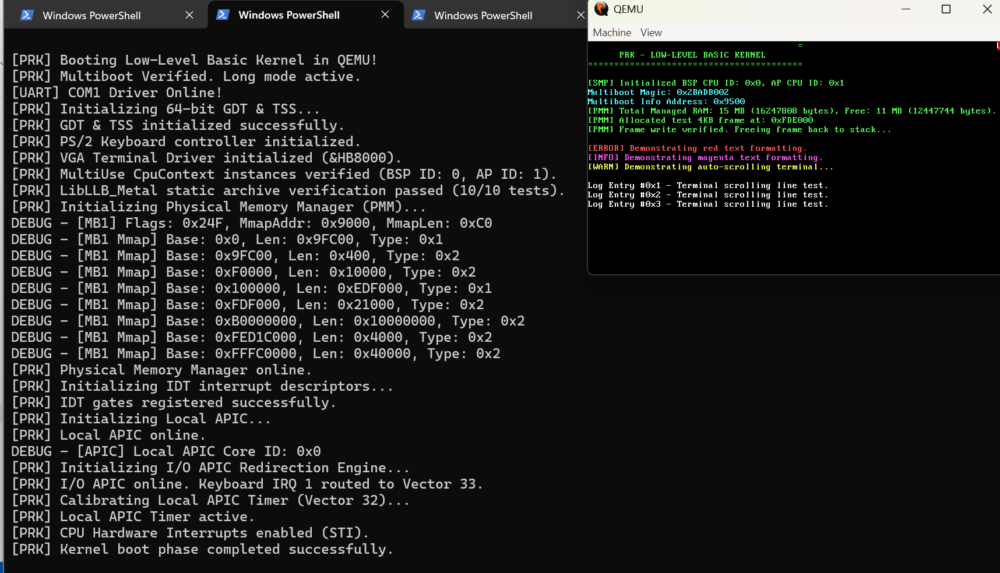

# PROS (Personal Research Operating System)

[](LICENSE.md)
[-informational.svg)](https://github.com/karunci/LLB)
[](docs/KERNEL_ROADMAP.md)
[-brightgreen.svg)](kernel/scripts/build_iso.sh)
[](AI_DISCLOSURE.md)

> **PROS** is a modern, modular 64-bit microkernel and graphical desktop operating system written in **Low-Level Basic (LLB)**, combining bare-metal systems performance with a clean, decoupled service architecture, dual-plane neural messaging, and double-buffered presentation compositing.

---

## 🌐 Multi-Branch Ecosystem Navigation
The Low-Level Basic repository is organized across three dedicated parallel branches:

| Subsystem | Branch | Architecture & Responsibility | Remote Link |
| :--- | :--- | :--- | :--- |
| **Stage-0 Bootstrap Compiler** | `main` | C++ bootstrap compiler emitting LLVM IR for freestanding & hosted targets. | [**View Branch: `main`**](https://github.com/karunci/LLB/tree/main) |
| **PROS Operating System** | `pros` | Complete 64-bit microkernel, system daemons (`services/`), GUI apps (`apps/gui/`), and SDK (`lib/`). | *Active Branch* |
| **Stage-1 Self-Hosted Compiler** | `stage1` | Pure Low-Level Basic self-hosting compiler designed to run natively inside PROS. | [**View Branch: `stage1`**](https://github.com/karunci/LLB/tree/stage1) |

---

## 🏛️ System Architecture

PROS is engineered with a strict microkernel design: only memory management, hardware interrupt orchestration, preemptive multi-core scheduling, and inter-process communication reside in Ring 0. All device drivers, filesystem handlers, window compositing, and user utilities run as isolated Ring 3 services.

```
+-----------------------------------------------------------------------------------+
|                           Ring 3: Graphical Desktop Apps                          |
|   +-------------------+  +--------------------+  +----------------------------+   |
|   | Terminal Emulator |  | System Telemetry   |  | Synapse Node Viewer        |   |
|   |  (apps/gui/term)  |  | (apps/gui/sys_mon) |  | (apps/gui/node_viewer)     |   |
|   +-------------------+  +--------------------+  +----------------------------+   |
+-----------------------------------------------------------------------------------+
|                           Ring 3: Core System Daemons                             |
|   +-------------------+  +--------------------+  +----------------------------+   |
|   | Window Manager    |  | Display Compositor |  | Virtual Filesystem (VFS)   |   |
|   |   (services/wm)   |  |   (compositor)     |  |   (services/vfs_srv)       |   |
|   +-------------------+  +--------------------+  +----------------------------+   |
|   +-------------------+  +--------------------+  +----------------------------+   |
|   | Device Manager    |  | Input Manager      |  | Plexus Message Bus         |   |
|   | (services/dev_mgr)|  | (services/input_srv|  | (services/plexus_mgr)      |   |
|   +-------------------+  +--------------------+  +----------------------------+   |
+-----------------------------------------------------------------------------------+
|                 Inter-Process Communication: Neural Synapse Channels             |
+-----------------------------------------------------------------------------------+
|                         Ring 0: PROS Supervisor Microkernel                       |
|   +---------------------------------------------------------------------------+   |
|   | Architecture HAL: SMP 4 Cores, LAPIC/IO-APIC, IDT Context Switching       |   |
|   | Memory Managers: PMM Free Stack, Buddy Allocator (64-128MB), VMM Paging   |   |
|   | Scheduler: Work-Stealing Preemptive Runqueues, Calibrated LAPIC Timers    |   |
|   | IPC & Dispatch: Synapse Channels, Fast Syscall Handler, Zero-Copy Rings   |   |
|   +---------------------------------------------------------------------------+   |
+-----------------------------------------------------------------------------------+
```

---

## 🚀 Key Architectural Features

- **Freestanding Safety & Multi-Order Buddy Allocator:**
  Zero dynamic heap allocations during early supervisor bootstrap. A dedicated 64 MB buddy pool (`&H4000000` to `&H8000000`) and Physical Memory Manager (PMM) operate on strictly disjoint physical address spaces to prevent double allocation.
- **Symmetric Multiprocessing (SMP):**
  Boots all Application Processors (APs) via calibrated Local APIC timers and PIT Channel 2 measurement. Provides multi-core preemptive scheduling with SSE register preservation across interrupt contexts.
- **Neural Synapse Inter-Process Communication:**
  Lockless, zero-copy ring buffers supporting both high-throughput streaming channels and blocking event queues (`SYS_SYNAPSE_POP`) that allow Ring 3 services to sleep with 0% CPU consumption when idle.
- **Double-Buffered Display Compositor:**
  Full 32-bit ARGB rasterization into a private RAM backbuffer (`backSurf`) with minimal union dirty-rectangle tracking and 32-bit DWORD-aligned burst flushes (`fast_blit32`) over PCIe to uncacheable Linear Framebuffer (LFB) MMIO apertures.
- **Hybrid Desktop Filesystem (`C:\` & `/system`):**
  Clean hybrid Windows + Android hierarchy providing intuitive paths for system assets, drivers, fonts, configuration, and user documents.

---

## 📂 Source Code Hierarchy

```text
pros/
├── kernel/                     # Ring 0 Supervisor Microkernel
│   ├── src/
│   │   ├── arch/x86_64/        # Boot stubs, IDT/GDT, LAPIC/IO-APIC, SMP, context switch
│   │   ├── core/               # Microkernel entry point, kernel heap, panic handler
│   │   ├── mem/                # PMM, VMM 4-level paging, Buddy allocator
│   │   ├── sync/               # Spinlocks, atomic barriers
│   │   ├── time/               # PIT calibration, LAPIC timer ticks
│   │   ├── drivers/            # Early GOP framebuffer, COM1 serial UART, PS/2 8042
│   │   └── tests/              # In-kernel self-tests (VMM isolation, buddy stress)
│   ├── Kernel.llbproj          # Microkernel project manifest
│   └── scripts/
│       └── build_iso.sh        # Hybrid UEFI/BIOS bootable ISO generation script
│
├── services/                   # Headless Core System Daemons (Ring 3)
│   ├── genesis/                # First userland process (PID 1) initializing services
│   ├── compositor/             # Double-buffered display server & dirty rect flusher
│   ├── wm/                     # Desktop window manager, event router, window frames
│   ├── vfs_srv/                # Virtual filesystem server (USTAR ramdisk & RAM-FS)
│   ├── dev_mgr/                # Hardware enumeration and device registry
│   ├── input_srv/              # PS/2 keyboard & mouse event processor
│   └── plexus_mgr/             # Synapse IPC name directory & routing hub
│
├── apps/                       # Native User Applications
│   ├── gui/                    # Graphical Desktop Applications
│   │   ├── sys_mon/            # Real-time CPU, memory, and telemetry monitor
│   │   ├── terminal/           # Graphical terminal emulator with font rasterizer
│   │   ├── node_viewer/        # Neural Synapse IPC channel visualizer
│   │   └── user_app/           # Interactive GUI demo application
│   └── cli/                    # Command-line tools (future)
│
├── lib/                        # Runtime Libraries & APIs
│   ├── pros/                   # Pure LLB Standard Library (System API, Synapse, GUI)
│   ├── metal/                  # Freestanding support library for kernel & boot code
│   └── runtime/                # brt0.S process entry stub, assembly memory primitives
│
├── include/                    # Shared Global Include Headers
│   ├── pros.bas                # Main client umbrella header for applications
│   ├── syscalls.bas            # Architecture syscall numbers & prototypes
│   └── synapse.bas             # Synapse IPC message structures & channels
│
├── tools/                      # Build & Emulation Utilities
│   ├── pack_initrd.sh          # Packages services & apps into USTAR ramdisk (initrd.tar)
│   └── run_qemu.ps1            # Windows PowerShell runner for QEMU emulation
│
└── docs/                       # Architectural Specifications & Roadmaps
```

---

## 🛠️ Building & Booting PROS

### Prerequisites
- **Low-Level Basic Compiler:** `llbc-stage0` (built from branch `main`).
- **Assembler & Linker:** `nasm`, embedded `lld` in `llbc-stage0`.
- **ISO Tools:** `xorriso`, `grub-mkrescue`, `mtools` (available directly on Termux/Ubuntu).
- **Virtual Machine:** `qemu-system-x86_64` (with WHPX/KVM acceleration recommended).

### 1. Build the Microkernel & All Services
From the root of the `pros` workspace:
```bash
# 1. Compile the supervisor microkernel
~/projects/LLB/llbc/build/llbc-stage0 kernel/Kernel.llbproj

# 2. Compile system daemons & applications, packaging the USTAR initrd ramdisk
bash tools/pack_initrd.sh

# 3. Assemble the bootable hybrid UEFI/BIOS ISO image
bash kernel/scripts/build_iso.sh
```

### 2. Run in QEMU

#### Headless Verification (Fast Smoke Test):
```bash
qemu-system-x86_64 -cdrom kernel/build/kernel.iso -smp 4 -m 1G -display none -serial stdio -no-reboot
```

#### Graphical Desktop Boot (Windows):
```powershell
powershell -ExecutionPolicy Bypass -File tools\run_qemu.ps1
```

Or via native QEMU:
```powershell
& "C:\Program Files\qemu\qemu-system-x86_64.exe" -cdrom kernel/build/kernel.iso -smp 4 -m 1G -vga std -serial stdio -no-reboot
```

---

## 📸 System Gallery

| Kernel Boot Banner (UEFI GOP & Serial) | Real-Time Telemetry & Desktop Compositor |
| :---: | :---: |
|  |  |

---

## 📖 Complete Documentation & Roadmaps

The [`docs/`](docs/) directory contains detailed architectural documents:

- 🗺️ **[Kernel Roadmap](docs/KERNEL_ROADMAP.md)** — Microkernel milestones (VMM, PMM, Buddy, SMP, ACPI, Interrupts).
- 🗺️ **[Core System Services Roadmap](docs/CORE_SYSTEM_ROADMAP.md)** — Daemons roadmap (Compositor, WM, VFS, DevMgr, Input).
- 🗺️ **[System Applications Roadmap](docs/SYSTEM_ROADMAP.md)** — GUI desktop applications and CLI tools.
- 🗺️ **[Runtime & Standard Library Roadmap](docs/STDLIB_AND_RUNTIME_ROADMAP.md)** — Standard library evolution and dynamic loaders.
- 📜 **[System API & ABI Specification](docs/SYSTEM_API_AND_ABI.md)** — Syscall convention, register dispatch, and Synapse channel protocol.
- 📚 **[Standard Library API Reference](docs/STANDARD_LIBRARY.md)** — Detailed manual for `lib/pros` APIs.
- 📦 **[BAX Executable Specification](docs/BAX_EXECUTABLE_SPECIFICATION.md)** — BAX binary format, section layout, and resource dictionaries.
- 🏛️ **[System Architecture Overview](docs/PROS_SYSTEM_ARCHITECTURE.md)** — Hybrid microkernel design, memory maps, and IPC topology.
- 🗂️ **[Directory Layout Specification](docs/DIRECTORY_LAYOUT.md)** — Complete file and folder hierarchy.

---

## 📄 License
This project is licensed under the Mozilla Public License 2.0 (MPL-2.0). See [LICENSE.md](LICENSE.md) for full details.
