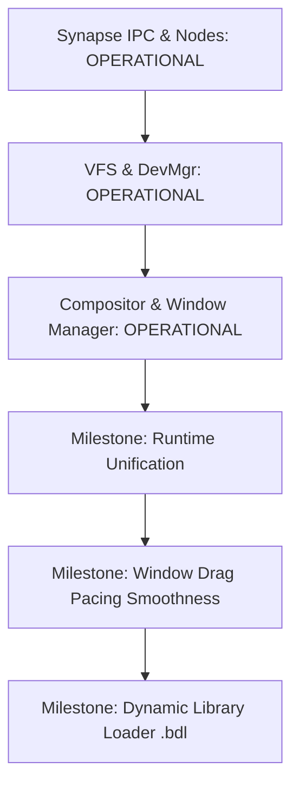

# PROS Core System Services Architecture & Roadmap (`CORE_SYSTEM_ROADMAP`)

> **Subsystem Scope:** Ring 3 Core System Daemons, IPC Fabric, and Windowing System  
> **Source Directory:** `services/`  
> **Status:** Operational on Bare-Metal, QEMU, and VirtualBox  

---

## 1. Core Services Architecture

PROS employs a **microkernel architecture** where major operating system services execute as isolated Ring 3 processes, communicating through the high-throughput **Neural Synapse IPC** channel mechanism.

```
                    ┌────────────────────────────┐
                    │      Window Manager        │
                    │         (srv.wm)           │
                    └─────────────┬──────────────┘
                                  │ Synapse IPC
┌──────────────────┐  Synapse IPC │  ┌──────────────────┐
│  Input Service   ├──────────────┼──┤  VFS Service     │
│   (srv.input)    │              │  │    (srv.vfs)     │
└─────────┬────────┘              │  └────────┬─────────┘
          │                       │           │
          ▼                       ▼           ▼
┌────────────────────────────────────────────────────────┐
│             Display Compositor Service                 │
│                  (srv.compositor)                      │
├────────────────────────────────────────────────────────┤
│        Hardware MMIO Framebuffer (PCIe Uncacheable)    │
└────────────────────────────────────────────────────────┘
```

---

## 2. Core Subsystems & Daemon Roles

### 2.1 Neural Node Registry & Synapse IPC
- **Node Registry (`services/node_mgr/`):** Manages the logical service topology. Processes register via `NodeRegister` (e.g. `"srv.vfs"`, `"srv.wm"`, `"srv.compositor"`) and resolve endpoints via `NodeLookup`.
- **Directed Synapses:** Point-to-point lockless ring buffer channels supporting bidirectional messaging with capability verification (`CAPS_READ`, `CAPS_WRITE`).
- **Axon Packets:** Standardized 64-byte message packets enabling zero-allocation message passing.

### 2.2 Virtual File System Service (`srv.vfs`)
- **Location:** `services/vfs_srv/`
- **Hybrid Path Support:** Supports unified Windows-style paths (`C:\System\Bin\genesis.bax`) and Unix/Android paths (`/system/bin/genesis.bax`).
- **RAM Disk Mount:** Parses Multiboot 2 USTAR `initrd` ramdisk images into an in-memory hierarchical directory tree.
- **IPC Protocol:** Responds to `VFS_CMD_STAT`, `VFS_CMD_OPEN`, `VFS_CMD_READ`, and `VFS_CMD_LIST` requests over Synapse.

### 2.3 Device Manager Service (`srv.dev_mgr`)
- **Location:** `services/dev_mgr/`
- **PCI Bus Enumeration:** Scans PCI configuration space (Buses 0–255, Slots 0–31, Functions 0–7) for graphics controllers, network cards, and storage devices.
- **Hardware Abstraction:** Exposes registered hardware nodes to client drivers.

### 2.4 Service Manager (`srv.service_mgr`)
- **Location:** `services/service_mgr/`
- **Daemon Lifecycle:** Starts, monitors, and restarts core system daemons in dependency order.
- **Heartbeat & Telemetry:** Monitors service liveness and reports status to the system monitor.

### 2.5 Input Service (`srv.input`)
- **Location:** `services/input_srv/`
- **Input Drivers:** Captures PS/2 keyboard scan codes and PS/2 mouse motion/button packets.
- **Event Dispatch:** Dispatches standardized input event packets to the active Window Manager and focused applications.

### 2.6 Display Compositor (`srv.compositor`)
- **Location:** `services/compositor/`
- **Double-Buffered Architecture:** Rasterizes all desktop surfaces, windows, titlebars, and controls into a contiguous RAM backbuffer (`backSurf`) in userland space (`PDPT[1]`).
- **PCIe Hardware Flushing (`fast_blit32`):** Flushes dirty bounding rectangles to physical VRAM using 32-bit DWORD-aligned scanline bursts (`rep movsl`).
- **Frame Pacing:** Runs at ~60 FPS with sub-tick yield loops, ensuring low hypervisor CPU overhead (1–4% VMM load).

### 2.7 Window Manager (`srv.wm`)
- **Location:** `services/wm/`
- **Z-Order Management:** Maintains window stacking order, focus activation, window creation, destruction, and movement.
- **Interactive Drag & Resize:** Supports corner and edge window resizing with absolute anchor offsets.
- **Client Surface Management:** Allocates zero-copy shared memory backbuffers for client application canvas drawing.

---

## 3. Implementation Status & Next Milestones



### Current Status
- [x] Synapse IPC ring buffer message passing with dual-plane data gradients.
- [x] In-memory USTAR VFS with dynamic mount arbiter (`/` TarFS, `/Users` RamFS).
- [x] Double-buffered display compositor with Discrete Damage Tracking (wlroots-style).
- [x] In-RAM software cursor plane eliminating PCIe MMIO read turnaround latency.
- [x] Partitioned SMP runqueues with idle task retention (`sti; hlt`), eliminating spinlock deadlocks.
- [x] Calibrated 100 Hz Local APIC timer and interrupt-driven PS/2 keyboard & mouse.
- [x] Multi-window desktop with live memory graphs, terminal, node inspector, and resource monitor.
- [x] Uncacheable PCIe MMIO mapping (`0x1F`) resolving hardware display artifacts.
- [x] PCI configuration bus driver and Ring 3 port I/O & PCI config access.
- [x] 2D screen boundary clipping for window dragging beyond display boundaries.

### Next Core Milestones
- [x] **CS.1:** Minimal Genesis PID 1 & Decoupled Plexus Manager PID 2 (`PROS-ARCH-GENESIS-01`):
  - Stripped all secondary service spawns from `KernelMain.bas`; kernel strictly initializes hardware and spawns `sys.genesis` (PID 1).
  - Minimal Genesis PID 1: Adopts orphaned/zombie processes, listens for shutdown/reboot signals, and spawns `srv.plexus_mgr` (PID 2).
  - Decoupled Plexus Manager PID 2: Reads boot initrd, summons Plexuses (`srv.vfs`, `srv.dev_mgr`, `srv.display`, `srv.input`, `srv.compositor`, `srv.wm`, and GUI apps) in staged dependency order, monitors heartbeats, and handles automatic service restarts. Verified live in `re40`.
- [ ] **CS.2:** Modular Compositor Display Backends (`PROS-ARCH-COMP-02`):
  - Decouple display presentation behind `IDisplayBackend` interface (`LfbBackend`, `SvgaBackend`, `VirtioGpuBackend`).
  - Wire VMware SVGA II FIFO commands and hardware cursor plane (`SVGA_CMD_DEFINE_CURSOR` + `SVGA_CMD_MOVE_CURSOR`).
- [ ] **CS.3:** Software Graphics & Rasterization Tier (`IRenderBackend`):
  - Implement freestanding 2D blitter and software OpenGL 1.x pipeline (`TinyGL / SoftGL`) in `lib/pros` for zero-dependency window canvas 3D rendering.
- [ ] **CS.4:** Window Manager Interactivity Polish:
  - Wire interactive Minimize, Maximize/Tile, and Close controls on window decorations; implement taskbar window list.
- [ ] **CS.5:** Port DOOM Engine (`doom.bax`):
  - Integrate `doomgeneric` to render inside a standard 640x400 window surface with keyboard input and sound synthesis.

