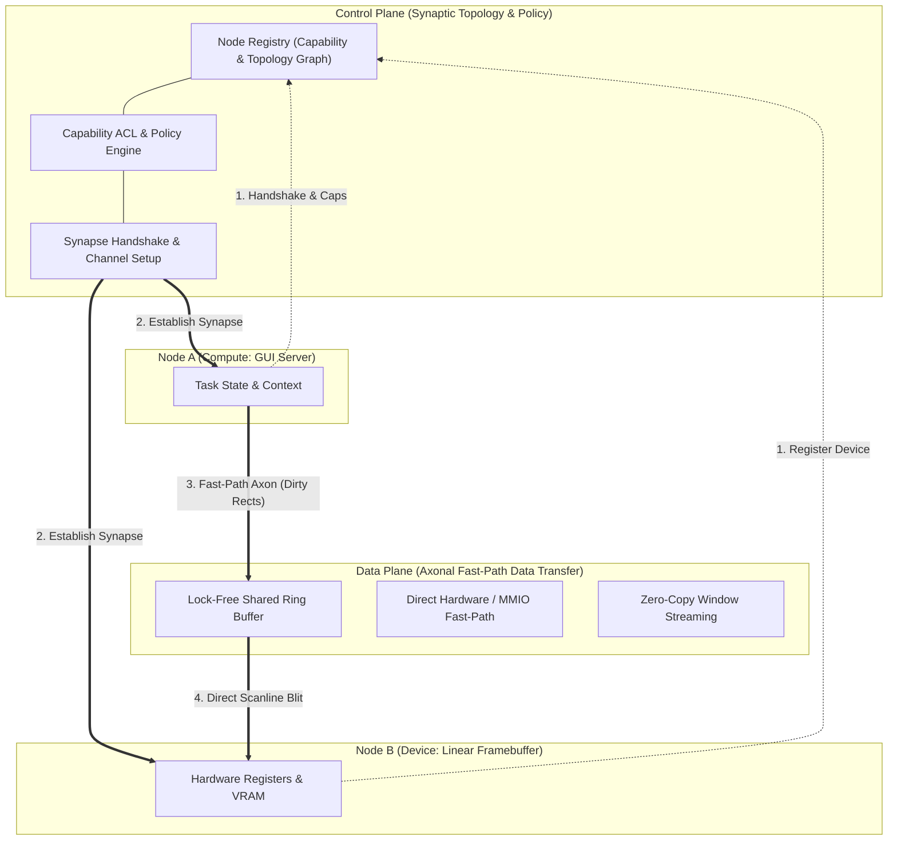
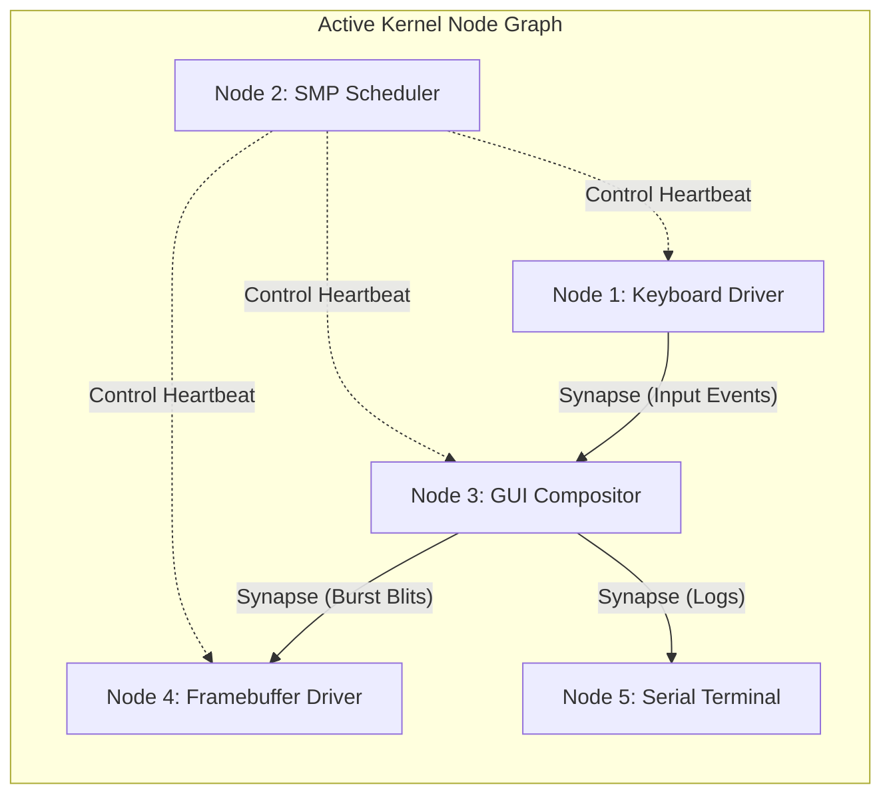
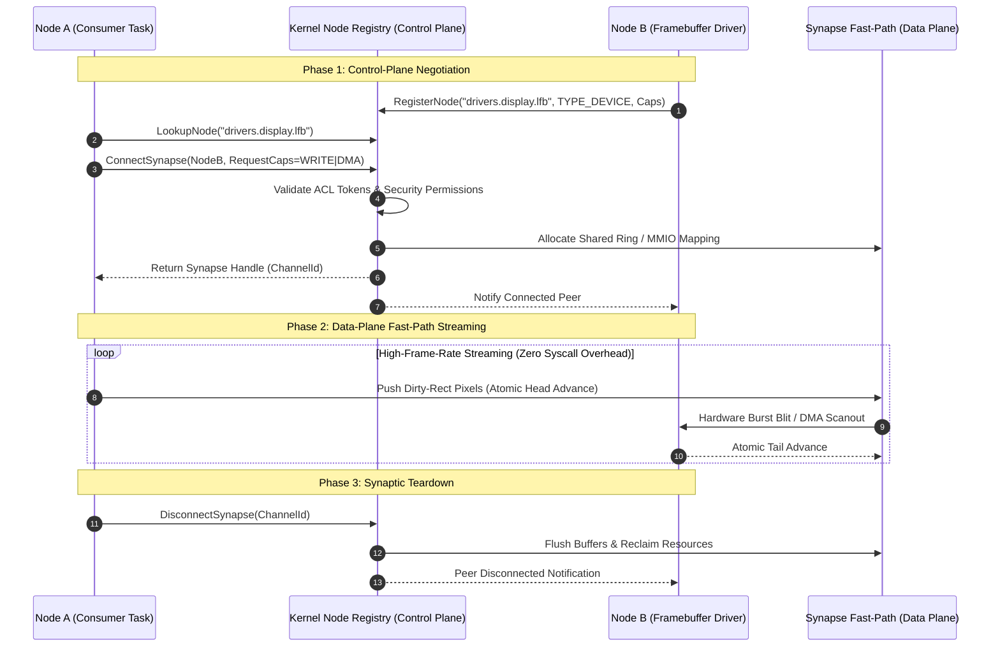

# Dual-Plane Neural Architecture Specification

> **Kernel Philosophy:** *"Everything is a Node"*  
> **Core Model:** Dual-Plane Hybrid (Control Plane + Data Plane)  
> **Target Subsystems:** Inter-Node Messaging, Device Drivers, Framebuffers, Memory Graphs, and Task Coordination.

---

## 1. Architectural Philosophy: *"Everything is a Node"*

Modern operating system kernels have historically centered on a unifying abstraction:
- **UNIX / Linux:** *"Everything is a file"* (Linear byte streams behind a VFS file descriptor table).
- **Plan 9:** *"Everything is a file server"* (Networked 9P protocol trees).
- **Redox OS:** *"Everything is a URL"* (Hierarchical URI resource schemes: `file:`, `event:`, `tcp:`).

### The Low-Level Basic Paradigm
Our microkernel adopts a neural-inspired paradigm:
> ### *"Everything is a Node connected via Synaptic Channels."*

In this architecture, every system resource is a discrete **Node**:
- A hardware device (UART, Framebuffer, NVMe, Keyboard) is a **Device Node**.
- A running thread or service is a **Compute Node**.
- A shared memory pool, buffer, or linear RAM window is a **Memory Node**.
- An event router, compositor, or IPC mailbox is a **Router Node**.

Nodes form a dynamic directed graph resembling a **neural network**. Interactions do not treat resources as dumb sequential byte streams; instead, they operate through **Synapses**—typed, capability-checked communication channels that separate policy decisions from high-speed data flow.

---

## 2. The Dual-Plane Hybrid Engine

Traditional microkernels suffer from the "IPC Tax"—every message exchange requires context switches, permission lookups, and queue serialization. The **Dual-Plane Architecture** eliminates this bottleneck by decoupling the **Control Plane** from the **Data Plane**.



### Plane Responsibilities

| Dimension | Control Plane (The Synapse) | Data Plane (The Axon) |
| :--- | :--- | :--- |
| **Primary Goal** | Security, Topology, Resource Discovery | Throughput, Zero-Copy Transfer, Low Latency |
| **Execution Path** | Capability ACL validation, QoS routing, Lifecycle | Lock-free atomics, MMIO burst writes, Direct Ring Buffers |
| **Intervention** | Only during channel setup, reconfiguration, or fault | Continuous bulk transmission without kernel traps |
| **Synchronization** | Ticket spinlocks, IRQ-save critical sections | Atomic head/tail indices, memory fences (`sfence`/`mfence`) |
| **Analogy** | Dendritic synaptic wiring & neurotransmitter signaling | Axonal action potential propagation |

---

## 3. Node & Synapse Topologies



### Node Types
1. **`NODE_TYPE_COMPUTE`:** Kernel worker threads, userspace tasks, or scheduler agents.
2. **`NODE_TYPE_DEVICE`:** Hardware controllers managing memory-mapped I/O or ports (UART, VGA, Framebuffer, Storage).
3. **`NODE_TYPE_STORAGE`:** Block caches, filesystems, and ramdisks.
4. **`NODE_TYPE_NETWORK`:** Packet ring buffers, NIC descriptors, and protocol sockets.
5. **`NODE_TYPE_MEMORY`:** Virtual memory spaces, Buddy allocator pools, and dynamic frame mappings.

### Synaptic Capability Flags
Permissions are negotiated at connection time:
- **`CAP_SYNAPSE_READ` (`&H01`):** Consumer permission to pull packets from channel.
- **`CAP_SYNAPSE_WRITE` (`&H02`):** Producer permission to push packets to channel.
- **`CAP_SYNAPSE_NOTIFY` (`&H04`):** Permission to register wake-up hooks on state changes.
- **`CAP_SYNAPSE_DMA` (`&H08`):** Permission to map physical memory directly into the data plane.
- **`CAP_SYNAPSE_ADMIN` (`&H80`):** Authority to sever, redirect, or inspect the synapse topology.

---

## 4. Communication Lifecycle Sequence



---

## 5. Low-Level Basic Implementation Architecture

### Control Plane Interface (`src/node/KernelNode.cls`)
```vb
Namespace Core.Nodes

    Public Enum NodeKind
        NODE_COMPUTE = 1
        NODE_DEVICE  = 2
        NODE_MEMORY   = 3
        NODE_ROUTER   = 4
    End Enum

    <Packed>
    Public Structure NodeDescriptor
        Public NodeId As UInt64
        Public Kind As NodeKind
        Public OwnerPid As UInt64
        Public Name(31) As Byte
        Public Capabilities As UInt32
        Public ActiveSynapses As UInt32
    End Structure

End Namespace
```

### Data Plane Channel Interface (`src/node/SynapseChannel.cls`)
```vb
Namespace Core.Nodes

    Public Class SynapseChannel
        Private channelId As UInt64
        Private sourceNode As UInt64
        Private targetNode As UInt64
        Private permissions As UInt32

        ' Lock-free circular ring buffer pointers
        Private ringPhysAddr As UInt64
        Private ringSize As UInt32
        Private headIndex As UInt32
        Private tailIndex As UInt32

        Public Function SendFast(ByVal dataPtr As Pointer To Byte, ByVal length As UInt32) As Boolean
            ' Fast-path data transfer with atomic index advance
        End Function
    End Class

End Namespace
```

---

## 6. Architectural Advantages

1. **Deterministic Latency:** Zero syscall interrupts during streaming transfers. Graphics compositing and audio streaming run without CPU pipeline flushes.
2. **Modular Granularity:** Drivers and applications can be dynamically rewired like neural circuits without restarting subsystems.
3. **Fine-Grained Capability Isolation:** Nodes cannot forge access to hardware devices without explicit cryptographic or ACL tokens negotiated via the Control Plane.
4. **Natural Hardware Acceleration:** Nodes seamlessly bridge software queues to physical hardware descriptors (e.g., GPU rings, virtio queues, NVMe submission queues).

---

## 7. Operational Verification & Display Output

The Dual-Plane Neural Architecture, BGA hardware graphics mode transition, and Axonal Data Plane packet exchange have been verified in QEMU running with 4 SMP cores and 512MB RAM:


- **Control Plane Registration:** Node #1000 (`core.kernel`, Compute) and Node #1001 (`drivers.display.lfb`, Device) registered dynamically.
- **Synapse Establishment:** Synapse Channel #5000 connected with capability masks `CAP_SYNAPSE_READ | CAP_SYNAPSE_WRITE`.
- **Axonal Fast-Path Delivery:** Verified packet sequence #1 delivery over lock-free circular ring buffers.
- **Hardware Graphics Mode:** BGA programmed to 1024x768x32 BPP true color mode with RAM double-buffering.

