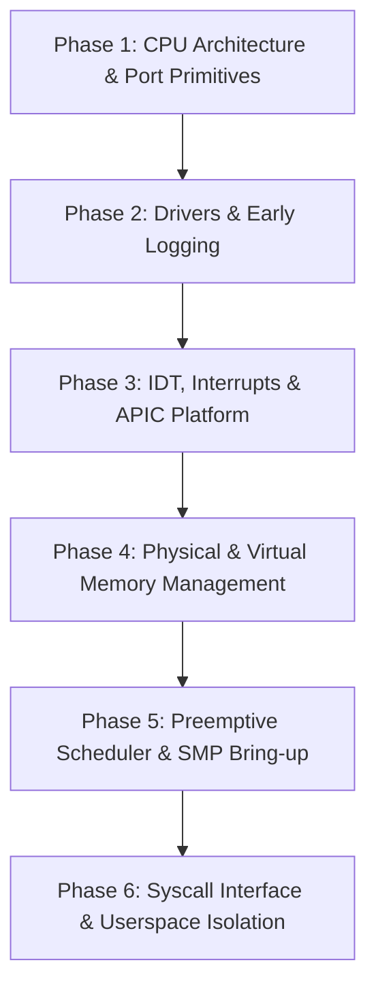

# PROS Microkernel Architecture & Roadmap (`KERNEL_ROADMAP`)

> **Target Architecture:** x86_64 Long Mode Bare-Metal Microkernel  
> **Source Directory:** `tests/kernel/src/` (`tests/kernel/Kernel.llbproj`)  
> **Compiler:** `llbc-stage0` (LLVM 21 backend, embedded LLD)  
> **Status:** Operational on Bare-Metal, QEMU (SMP 4), and VirtualBox  

---

## 1. Architectural Design & Philosophy

The PROS microkernel is implemented in **Low-Level Basic (LLB)**, engineered for high throughput, predictable latency, and memory isolation. Rather than raw procedural C code, it leverages LLB's native classes, explicit `<Packed>` and `<Align(N)>` structures, zero-cost interfaces, and atomic spinlocks.

### Language & Hardware Binding Matrix
| Subsystem Component | LLB Construct | Architectural Responsibility |
| :--- | :--- | :--- |
| **Port I/O & CPU Control** | `Arch.X86_64.PortIO` | Zero-overhead inline assembly wrappers (`InB`, `OutB`, `InW`, `OutW`, `Cli`, `Sti`, `Hlt`). |
| **GDT, IDT & TSS Descriptors** | `<Packed> Structure GdtEntry` | Enforces exact 8-byte and 16-byte TSS descriptor layouts with compile-time `#Assert`. |
| **PTE / Page Table Layouts** | `<Packed> Structure ... Field As Type * Bits` | Real bitfield layout for PML4/PDPT/PD/PT entries (Present, Writable, User, HugePage). |
| **Per-CPU Scratch Context** | `Class PerCpuContext` | Encapsulates logical CPU state, kernel stack, APIC ID, and current task with `<Instancing(MultiUse)>`. |
| **Interrupt Stack Framing** | `Structure InterruptFrame` | AMD64 16-byte stack aligned ISR frame preserving `%rdi..%r15` and 16 SSE vector registers (`%xmm0..%xmm15`). |
| **Physical Memory Allocator (PMM)**| `Class Mem.PhysicalMemoryManager` | Free-list page frame allocator (4KB granularity, stack-based). Strictly excludes Buddy & Ramdisk. |
| **Buddy Allocator** | `Class Mem.BuddyAllocator` | Multi-order buddy allocator managing physical page orders 0–10 (4KB to 4MB blocks). |
| **Virtual Memory Manager (VMM)** | `Class Mem.VirtualSpace` | 4-level PML4 address space isolation with strict supervisor/user separation. |
| **APIC / IO-APIC / SMP** | `Class Arch.LocalApic` | Local APIC calibrated via PIT Channel 2 (10ms tick baseline) and IO-APIC routing. |
| **Preemptive Scheduler** | `Class Sched.Scheduler` | SMP-aware round-robin preemptive scheduler with thread state, priorities, and sleep queues. |

---

## 2. Kernel Phased Implementation Status

### Phase 1: CPU Core & Architecture Primitives
- [x] Port I/O inline assembly routines (`InB`, `OutB`, `InW`, `OutW`, `IoWait`).
- [x] 64-bit Global Descriptor Table (GDT) and Task State Segment (TSS) per CPU.
- [x] High-performance atomic spinlocks with pause loops and compiler early-clobber operands.

### Phase 2: Device Drivers & Character Output
- [x] COM1 16550 UART serial driver (115200 baud, 8N1).
- [x] Linear Framebuffer (GOP) early boot console renderer.
- [x] PS/2 keyboard controller driver with modifier tracking.

### Phase 3: IDT, Interrupts & Platform APIC
- [x] 256-entry Interrupt Descriptor Table (IDT) with exception trap gates.
- [x] Interrupt context preservation for AMD64 scalar registers (`%rax..%r15`) and SIMD registers (`%xmm0..%xmm15`).
- [x] Local APIC initialization and calibration via PIT timer (measuring ticks over 10ms).
- [x] IO-APIC redirection table configuration for hardware IRQs (PS/2 Keyboard IRQ 1, PS/2 Mouse IRQ 12).

### Phase 4: Memory Management (PMM, Buddy, VMM)
- [x] **Physical Memory Manager (PMM):** 4KB page stack allocator scanning Multiboot memory map.
- [x] **Buddy Allocator:** Dedicated non-overlapping 64MB–128MB physical window for multi-order contiguous allocations.
- [x] **Virtual Memory Manager (VMM):** 4-level paging with higher-half kernel mapping and userland address isolation in `PDPT[1]` (`0x40000000` to `0x78000000`).
- [x] Identity page mapping covering 0–16GB physical space to support high-aperture PCIe framebuffers on UEFI.

### Phase 5: Preemptive Multitasking & SMP Multi-Core
- [x] Task Control Block (TCB) with user/kernel stack pointers, CR3, and scheduling quantum.
- [x] SMP AP core bootstrap via INIT-SIPI-SIPI sequence.
- [x] 100 Hz LAPIC timer preemptive scheduling tick.
- [x] `ProcessSleep` with timer queue and scheduler CPU halt (`sti; hlt`) on idle.

### Phase 6: System Call Interface & Protection Boundaries
- [x] Fast `syscall`/`sysret` mechanism via AMD64 `STAR`, `LSTAR`, and `SFMASK` MSRs.
- [x] Kernel stack isolation on entry via per-CPU scratch base.
- [x] System call dispatch table for process lifecycle, IPC, memory mapping, and console output.

---

## 3. Kernel ABI & Syscall Specification

| Syscall Number | Name | Arguments | Description |
| :--- | :--- | :--- | :--- |
| `0x01` | `SYS_CONSOLE_WRITE` | `(strPtr As Pointer To Byte, len As UInt64)` | Outputs string to COM1 and framebuffer. |
| `0x02` | `SYS_PROCESS_YIELD` | `()` | Voluntarily yields remaining CPU quantum. |
| `0x03` | `SYS_PROCESS_SLEEP` | `(ms As UInt64)` | Suspends caller for `ms` milliseconds. |
| `0x04` | `SYS_PROCESS_EXIT` | `(code As UInt64)` | Terminates calling process cleanly. |
| `0x05` | `SYS_PROCESS_GETPID`| `()` | Returns current process identifier. |
| `0x06` | `SYS_GET_CORE_COUNT`| `()` | Returns total active online SMP cores. |
| `0x07` | `SYS_GET_UPTIME` | `()` | Returns system uptime in milliseconds. |
| `0x08` | `SYS_ALLOC_PAGES` | `(count As UInt64, targetVaddr As UInt64)` | Maps anonymous physical pages into `PDPT[1]`. |
| `0x10` | `SYS_SYNAPSE_CONNECT`| `(srcId, dstId, caps)` | Establishes directed IPC communication channel. |
| `0x11` | `SYS_SYNAPSE_PUSH` | `(synId, pktPtr)` | Sends axon packet over synapse channel. |
| `0x12` | `SYS_SYNAPSE_POP` | `(synId, pktPtr)` | Receives incoming packet (blocking/non-blocking). |
| `0x20` | `SYS_FB_GET_INFO` | `(infoPtr)` | Retrieves framebuffer dimensions, pitch, and bpp. |
| `0x21` | `SYS_FB_MAP` | `(targetVaddr)` | Maps physical VRAM aperture into userspace (`0x1F` uncacheable). |

---

## 4. Next Kernel Milestones

- [ ] **K.1:** Complete Kernel ABI type modernization (adopt `ProcessId`, `Handle`, `VirtualAddress`, and typed enums).
- [ ] **K.2:** Inter-Core IPI (Inter-Processor Interrupt) cross-core task migration and TLB shootdown.
- [ ] **K.3:** Dynamic ELF / BAX kernel module loader for loadable device drivers.

