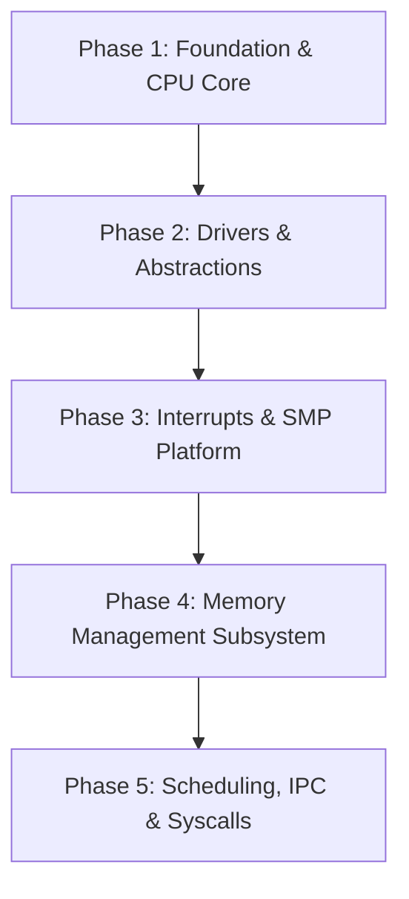

# PRK Kernel to Low-Level Basic (LLB) Porting Roadmap

> **Target Architecture:** x86_64 Long Mode Bare-Metal Microkernel  
> **Source Repository:** `~/projects/PRK_TO_PORT_TO_LLB/` (`T:\projects\PRK_TO_PORT_TO_LLB`)  
> **Destination:** `tests/kernel/src/` (compiled via `tests/kernel/Kernel.llbproj`)  
> **Compiler:** `llbc-stage0` (LLVM 21 backend, embedded LLD)

---

## 1. Architectural Design & LLB Language Idioms

Rather than writing simple monolithic C-style procedural modules (`.bas`), the ported kernel leverages the full object-oriented and systems capabilities of **Low-Level Basic**:

### Language Feature Utilization Matrix

| Subsystem Component | LLB Construct | Architectural Role & Justification |
| :--- | :--- | :--- |
| **Port I/O & CPU Primitives** | `Namespace Arch.X86_64` + `Module PortIO` | Zero-overhead inline assembly wrappers (`InB`, `OutB`, `InW`, `OutW`, `IoWait`, `Hlt`, `Cli`, `Sti`) with `Unsafe` fences. |
| **GDT & Segment Descriptors** | `<Packed> Structure GdtEntry`, `Structure GdtDescriptor` | Enforces exact 8-byte and 16-byte TSS descriptor layout with `#Assert SizeOf(GdtTable) = ...`. |
| **Hardware Descriptors (PTE/IDT)** | `<Packed> Structure ... Field As Type * Bits` | Real bitfield layout for Page Table Entries (Present, Writable, User, HugePage, FrameAddress) and IDT Gate flags. |
| **Per-CPU Scratch & State** | `Class PerCpuContext` with `<Instancing(MultiUse)>` | Encapsulates logical CPU state, kernel stack pointer, APIC ID, and current task pointer with explicit `.Initialize(cpuId)`. |
| **Console & Character Devices** | `Interface ICharDevice` + `Implements` | Abstract I/O interface declaring `Sub WriteChar(ByVal ch As Byte)` and `Sub WriteString(...)`. Implemented by both `VgaTerminal` and `SerialUart`. |
| **Drivers (UART, PS/2 Keyboard)** | `Class Drivers.SerialUart`, `Class Drivers.Keyboard` | Encapsulates controller state, I/O ports, FIFO ring buffers, and modifier key tracking with `<Instancing(SingleUse)>`. |
| **Synchronization Primitives** | `Structure Spinlock` with atomic intrinsics | High-signal, ticket or test-and-set SMP spinlocks guarding driver and scheduler state. |
| **Physical Memory Allocator (PMM)** | `Class Mem.PhysicalMemoryManager` (`<Instancing(SingleUse)>`) | Intrusive free-list physical page frame allocator (4KB granularity, stack-based). |
| **Virtual Memory Manager (VMM)** | `Class Mem.VirtualSpace` + `Structure PageTable` | Scoped page directory manipulation, 4-level PML4 translation, and kernel higher-half mappings. |

---

## 2. Phased Implementation Roadmap



---

### Phase 1: CPU Architecture & Port Primitives
**Goal:** Establish fundamental x86_64 register operations, Port I/O, 64-bit GDT, and TSS.

1. **`src/arch/x86_64/PortIO.bas` (Namespace `Arch.X86_64`):**
   - Source: `include/prk/port_io.h`
   - Routines: `InB`, `OutB`, `InW`, `OutW`, `IoWait` via GCC-style `Asm` with `"a"` and `"Nd"` constraints.
2. **`src/arch/x86_64/Gdt.bas` / `src/arch/x86_64/GdtTypes.bas`:**
   - Source: `include/prk/gdt.h`, `include/prk/tss.h`, `kernel/gdt.c`, `kernel/tss.c`
   - Structs: `<Packed> Structure GdtEntry`, `<Packed> Structure TssDescriptor`, `<Packed> Structure TssEntry`.
   - Invariants: `#Assert SizeOf(GdtEntry) = 8`, `#Assert SizeOf(TssDescriptor) = 16`.
   - Procedure: `Unsafe Sub Initialize(ByVal cpuId As UInt32)` loading GDT via inline `lgdt` and TSS via `ltr`.
3. **`src/sync/Spinlock.bas` (Namespace `Sync`):**
   - Source: `include/prk/spinlock.h`, `kernel/spinlock.c`
   - Struct: `Structure Spinlock` (`Public locked As UInt32`).
   - Procedures: `Acquire`, `Release`, `TryAcquire` with compiler atomic built-ins or pause loops.

---

### Phase 2: Device Abstractions & Early Logging Drivers
**Goal:** Decouple character output using LLB Interfaces, enabling early COM1 serial output and PS/2 keyboard input.

1. **`src/drivers/ICharDevice.cls` (Namespace `Drivers`):**
   - Interface definition:
     ```vb
     Interface ICharDevice
         Sub WriteChar(ByVal ch As Byte)
         Sub WriteString(ByVal str As Pointer To Byte)
     End Interface
     ```
2. **`src/drivers/SerialUart.cls` (Namespace `Drivers`):**
   - Source: PRK COM1 early logging logic.
   - Class: `<Instancing(SingleUse)> Class SerialUart`
   - Implements: `Implements ICharDevice`
   - Encapsulates: COM1 port base `&H3F8`, baud rate divisor setting, line control register, and status checks.
3. **`src/drivers/Keyboard.cls` (Namespace `Drivers`):**
   - Source: `include/prk/keyboard.h`, `kernel/keyboard.c`
   - Class: `<Instancing(SingleUse)> Class Keyboard`
   - Encapsulates: Ports `&H60` / `&H64`, 256-byte circular scancode buffer, Shift/Ctrl/Alt modifier states, and US QWERTY scancode lookup table.

---

### Phase 3: Interrupts, Exceptions & APIC Platform
**Goal:** Complete IDT gate registration with `<Interrupt>` handlers and setup local APIC / IO-APIC.

1. **`src/arch/x86_64/Idt.bas` Refactoring:**
   - Source: `include/prk/idt.h`, `kernel/idt.c`, `kernel/isr.S`
   - Structs: `<Packed> Structure IdtEntry` with bitfield attributes:
     ```vb
     <Packed>
     Structure IdtEntry
         Public OffsetLow As UInt16
         Public Selector As UInt16
         Public Ist As Byte * 3
         Public Reserved0 As Byte * 5
         Public GateType As Byte * 4
         Public ZeroBit As Byte * 1
         Public Dpl As Byte * 2
         Public Present As Byte * 1
         Public OffsetMid As UInt16
         Public OffsetHigh As UInt32
         Public Reserved1 As UInt32
     End Structure
     #Assert SizeOf(IdtEntry) = 16
     ```
   - Handlers: Exception ISRs decorated with `<Interrupt>` attribute.
2. **`src/arch/x86_64/Apic.bas` & `IoApic.bas`:**
   - Source: `include/prk/apic.h`, `include/prk/ioapic.h`, `kernel/apic.c`, `kernel/ioapic.c`
   - Module: Memory-mapped I/O using `Volatile Pointer To UInt32` for LAPIC registers (Spurious Vector, EOI, ICR, Timer).

---

### Phase 4: Memory Management (PMM & VMM)
**Goal:** Self-contained physical page frame allocator and 4-level x86_64 page directory management.

1. **`src/mem/PhysicalMemoryManager.cls` (Namespace `Mem`):**
   - Source: `include/prk/pmm.h`, `kernel/pmm.c`
   - Class: `<Instancing(SingleUse)> Class PhysicalMemoryManager`
   - Encapsulates: Intrusive singly-linked physical free-list stack (`free_frame_t`), total memory bytes, free frames, and frame allocation / deallocation routines (`AllocPage`, `FreePage`).
2. **`src/mem/PageTableTypes.bas` & `src/mem/VirtualManager.cls`:**
   - Source: `include/prk/vmm.h`, `kernel/vmm.c`
   - Bitfield Page Table Entries:
     ```vb
     <Packed>
     Structure PageTableEntry
         Public Present As Byte * 1
         Public Writable As Byte * 1
         Public UserAccessible As Byte * 1
         Public WriteThrough As Byte * 1
         Public CacheDisabled As Byte * 1
         Public Accessed As Byte * 1
         Public Dirty As Byte * 1
         Public HugePage As Byte * 1
         Public Global As Byte * 1
         Public Available As Byte * 3
         Public FrameAddress As UInt64 * 40
         Public AvailableHigh As UInt16 * 11
         Public NoExecute As Byte * 1
     End Structure
     #Assert SizeOf(PageTableEntry) = 8
     ```
   - Class: `Class VirtualManager` providing `MapPage`, `UnmapPage`, and page table walker routines.
3. **`src/mem/KernelHeap.cls`:**
   - Source: `include/prk/heap.h`, `kernel/heap.c`
   - Bump and slab/freelist allocator for kernel dynamic allocations.

---

### Phase 5: Multitasking, IPC & System Calls
**Goal:** Cooperative/preemptive thread scheduling, Inter-Process Communication, and x86_64 `syscall`/`sysret` mechanism.

1. **`src/sched/Task.cls` (Namespace `Sched`):**
   - Source: `include/prk/sched.h`, `kernel/sched.c`, `kernel/switch.S`
   - Encapsulates: Task ID, execution state (Ready, Running, Blocked), CPU register context, kernel stack pointer, and page directory (CR3).
2. **`src/sched/Scheduler.cls`:**
   - Round-robin task queue and context-switching routines.
3. **`src/ipc/MessageQueue.cls` (Namespace `Ipc`):**
   - Source: `include/prk/ipc.h`, `kernel/ipc.c`
   - Porting synchronous and asynchronous IPC messaging.
4. **`src/sys/Syscall.bas` (Namespace `Sys`):**
   - Source: `include/prk/syscall.h`, `kernel/syscall.c`, `kernel/syscall_entry.S`
   - MSR configuration (`MSR_EFER`, `MSR_STAR`, `MSR_LSTAR`, `MSR_FMASK`) and system call dispatcher.

---

## 3. Directory Layout in `tests/kernel/`

The ported files will be organized into a modern modular structure:

```text
tests/kernel/
├── Kernel.llbproj                  <-- Updated project manifest
├── linker.ld
└── src/
    ├── KernelMain.bas              <-- Kernel entrypoint & subsystem orchestrator
    ├── arch/
    │   └── x86_64/
    │       ├── boot.S              <-- Multiboot1/2 assembly entry
    │       ├── PortIO.bas          <-- Namespace Arch.X86_64, Module PortIO
    │       ├── GdtTypes.bas        <-- Packed GDT/TSS structures & static asserts
    │       ├── Gdt.bas             <-- GDT initialization & reload routines
    │       ├── IdtTypes.bas        <-- Packed IDT structures & bitfields
    │       ├── Idt.bas             <-- IDT registration & handlers
    │       ├── Apic.bas            <-- Local APIC MMIO controller
    │       └── IoApic.bas          <-- I/O APIC routing
    ├── sync/
    │   └── Spinlock.bas            <-- Atomic SMP spinlocks
    ├── drivers/
    │   ├── ICharDevice.cls         <-- Abstract character device interface
    │   ├── Terminal.bas            <-- VGA Text Mode terminal driver
    │   ├── SerialUart.cls          <-- 16550 UART serial driver (Implements ICharDevice)
    │   └── Keyboard.cls            <-- PS/2 Keyboard controller class
    └── mem/
        ├── PmmTypes.bas            <-- Frame structures & constants
        ├── PhysicalMemoryManager.cls <-- PMM intrusive free-list frame allocator
        ├── PageTableTypes.bas      <-- 64-bit PTE bitfield structures
        └── VirtualManager.cls      <-- 4-level paging manager
```

---

## 4. Current Progress & Verification Status

### Phase 1 & Phase 2: COMPLETE and Verified in QEMU (64-bit Long Mode)
- [x] **Compiler Core Extensions (`llbc-stage0`):**
  - Inline `Asm` statement operand parsing (`[output : input : clobbers]`) with GCC-to-LLVM register constraint mapping (`=a` -> `={ax}`, `Nd` -> `N{dx}`, `memory` -> `~{memory}`).
  - Multi-line `Asm` instruction string literal concatenation with `\n\t`.
  - Multi-part dotted type spec parsing (`while match(Dot) ...`) and suffix type resolution across namespaces (`Sync.Spinlock` -> `SpinlockOps.Spinlock`).
  - Recursive nested `Namespace` block parsing supporting multiple `Class`, `Module`, and `Interface` definitions within the same container block.
  - Container-level `<Instancing(...)>` attribute recognition directly preceding nested classes with default fallback to `MultiUse`.
  - Intra-class member procedure resolution and automatic `Me` pointer argument injection with optional parameter default value substitution.
  - `<Instancing(SingleUse)>` singleton symbol generation (`__singleton_<NormClass>`) and automated `Me` pointer argument injection on method calls (`Drivers.Terminal.Initialize`, `Drivers.SerialUart.Initialize`).
  - Implicit `Me` pointer access for class field reads, array index writes, and member subroutine calls.
- [x] **Bare-Metal Bootloader & Runtime (`boot.S`):**
  - Activated SSE vector instructions in 64-bit CR4/CR0 (`CR4.OSFXSR`, `CR4.OSXMMEXCPT`, `CR0.MP`, clear `CR0.EM`) to guarantee LLVM struct zeroing does not trigger #GP.
  - Added freestanding runtime symbols (`abort`, `dprintf`).
- [x] **Subsystem Drivers & Modules:**
  - `src/arch/x86_64/PortIO.bas`: Port I/O primitives (`InB`, `OutB`, `InW`, `OutW`, `IoWait`).
  - `src/arch/x86_64/GdtTypes.bas` & `Gdt.bas`: Packed GDT and TSS segment descriptors.
  - `src/sync/Spinlock.bas`: Atomic ticket/flag spinlocks with pause loops.
  - `src/drivers/ICharDevice.cls`: Abstract character device interface (`Namespace Drivers`).
  - `src/drivers/SerialUart.cls`: 16550 UART COM1 driver (`&H3F8`) implementing `ICharDevice` (`<Instancing(SingleUse)>`).
  - `src/drivers/Keyboard.cls`: PS/2 Keyboard controller class (`&H60`/`&H64`) (`<Instancing(SingleUse)>`).
  - `src/drivers/Terminal.cls`: Bare-metal VGA Text Mode 80x25 console driver class implementing `ICharDevice` (`<Instancing(SingleUse)>`).
  - `src/KernelMain.bas`: Orchestrated kernel entry verifying long mode, UART COM1, GDT/TSS, Keyboard, VGA Terminal, and IDT gates.
- [x] **Verification:**
  - 100% test pass on userland suite (all 65 tests + 26 compiler rejection guards).
  - Clean QEMU execution to halt with verified serial output:
    ```
    [PRK-OS KERNEL] Booting Low-Level Basic Kernel in QEMU!
    [PRK-OS KERNEL] Multiboot Verified. Long mode active.
    [UART] COM1 Driver Online!
    [PRK-OS KERNEL] Initializing 64-bit GDT & TSS...
    [PRK-OS KERNEL] GDT & TSS initialized successfully.
    [PRK-OS KERNEL] PS/2 Keyboard controller initialized.
    [PRK-OS KERNEL] VGA Terminal Driver initialized (&HB8000).
    [PRK-OS KERNEL] Initializing IDT interrupt descriptors...
    [PRK-OS KERNEL] IDT gates registered successfully.
    [PRK-OS KERNEL] Kernel execution completed successfully. Halting CPU.
    ```

### Phase 4: Memory Management Subsystem (PMM, Buddy Allocator, VMM)
- [x] **`src/mem/PhysicalMemoryManager.cls` (Namespace `Mem`):**
  - Intrusive singly-linked physical free-list stack allocator managing page allocation, reservation, and Multiboot1/2 memory map traversal.
- [x] **`src/mem/BuddyAllocator.cls` (Namespace `Mem` / `<Instancing(SingleUse)> Class BuddyAllocator`):**
  - Binary Buddy Page Allocator with 11 orders (Order 0: 4KB to Order 10: 4MB blocks) across 64MB managed memory pool.
  - Verified in QEMU: dynamic page splitting down to Order 0, recursive buddy coalescing back to Order 10.
- [x] **`src/mem/VirtualMemoryManager.cls` (Namespace `Mem` / `<Instancing(SingleUse)> Class VirtualMemoryManager`):**
  - 4-level x86_64 Virtual Memory Manager (`Pml4Index`, `PdptIndex`, `PdIndex`, `PtIndex`).
  - Implements `MapPage`, `UnmapPage`, `VirtToPhys`, `MapRange`, and TLB invalidation (`invlpg`).
- [x] **`src/mem/KernelHeap.cls` (Namespace `Mem` / `<Instancing(SingleUse)> Class KernelHeap` aliased as `KHeap`):**
  - 16-byte aligned kernel dynamic heap allocator (`KMalloc`, `KFree`) with intrusive doubly-linked boundary tags (`KBlockHeader`).
  - Mirrors PRK `kernel/heap.c`: dynamic block splitting and bidirectional boundary tag coalescing on free.
  - Verified in QEMU: mapped 1MB pool at `0x81000000`, allocated 128-byte block at `0x81000020`, verified 64-bit pattern write (`0xCAFEBABEDEADBEEF`), and cleanly recycled back to the arena.

---

### Phase 5: Platform Architecture, APIC, ACPI, CPU Topology & SMP Bring-up
- [x] **`src/arch/x86_64/Apic.bas` & `IoApic.bas` (Namespace `Arch.X86_64`):**
  - Local APIC driver with CPUID-based x2APIC detection and fallback to physical MMIO at `0xFEE00000`.
  - Configures Spurious Vector, EOI signaling, and LAPIC Timer calibration (Vector 32).
  - I/O APIC redirection engine routing PS/2 Keyboard IRQ 1 to IDT Vector 33.
- [x] **`src/arch/x86_64/Acpi.bas` (Namespace `Arch` / `Module Acpi`):**
  - Reads RSDP from Multiboot2 tags (types 14 and 15) matching PRK `kernel/acpi.c` logic.
  - Parses MADT (Multiple APIC Description Table) to enumerate physical LAPIC IDs (`discoveredApicIds`) and I/O APIC MMIO addresses.
  - Parses FADT (Fixed ACPI Description Table) to locate ACPI Power Management registers (`PM1a_CNT_BLK`, `S5` sleep object).
  - Implements clean software reset via Port `0x64` / `0xCF9` and ACPI S5 shutdown.
- [x] **`src/arch/power/PowerManager.cls` (Namespace `Arch.Power` / `<Instancing(SingleUse)> Class PowerManager` aliased as `Power`):**
  - Object-oriented power management facade wrapping ACPI S5 shutdown and system reboot.
- [x] **`src/sys/HardwareInfo.cls` (Namespace `Sys` / `Class HardwareInfo` aliased as `HwInfo`):**
  - CPUID leaf 0 / 0x80000002-4 query extracting CPU vendor string (`AuthenticAMD` / `GenuineIntel`) and model brand string.
  - CPU feature flag decoder (FPU, APIC, SSE, SSE2, SSE3, AVX) and Invariant TSC detection (Leaf 0x80000007 EDX bit 8).
  - Verified in QEMU: cleanly prints vendor and model strings to serial COM1 console.
- [x] **`src/arch/x86_64/Smp.bas` & `boot.S` AP Trampoline:**
  - Relocatable 16-bit real mode -> 32-bit protected mode -> 64-bit long mode AP trampoline assembled at `0x8000`.
  - Dispatches standard INIT-SIPI-SIPI sequence to each active AP core enumerated by ACPI MADT.
  - BSP <-> AP atomic join counter synchronization and dedicated per-CPU stack switching jumping to `Arch_Smp_ApMain`.
  - Verified in QEMU: single-core detection correctly handles MB1 environment without hanging.

---

### Phase 6: Preemptive Scheduler, Task Context & TCB
- [x] **`src/arch/x86_64/CpuContext.cls` (Namespace `Arch.X86_64` / `<Instancing(MultiUse)> Class CpuContext`):**
  - Per-CPU context holding saved register frame, APIC ID, kernel stack base, and current task pointer.
- [x] **`src/sched/TaskTypes.bas` (Namespace `Sched` / `Module TaskRoutines`):**
  - `<Packed> Structure TaskControlBlock` (TCB): PID, PPID, `ThreadState`, `ThreadType`, priority, wake-up timestamp, CPU ticks, signal bitmask, CR3 root, kernel stack base, `ContextRsp`, and circular linked-list `NextTask` pointer.
  - `Enum ThreadState` (`STATE_READY=0`, `STATE_RUNNING=1`, `STATE_BLOCKED=2`, `STATE_TERMINATED=3`).
  - `Enum ThreadType` (`TYPE_RTOS=0`, `TYPE_GPOS=1`).
  - `Unsafe Sub CpuIdleLoop()`: Infinite `sti/hlt` idle loop for when the runqueue is empty (mirrors PRK `cpu_idle_loop()`).
- [x] **`src/sched/TaskControlBlock.cls` (Namespace `Sched` / `<Instancing(SingleUse)> Class TaskControlBlock`):**
  - Factory and lifecycle manager for TCB allocation (`KMalloc`), initialization, and destruction (`KFree`).
  - `Function CreateTask(...)`: Allocates and initializes a TCB node; wires `NextTask` pointer into circular list.
  - `Sub DestroyTask(...)`: Releases TCB memory and delinks from the circular list.
- [x] **`src/sched/Scheduler.cls` (Namespace `Sched` / `<Instancing(SingleUse)> Class Scheduler`):**
  - Round-robin preemptive scheduler driven by APIC Timer interrupts.
  - `Sub Initialize()`: Creates kernel idle task pointing to `Sched_TaskRoutines_CpuIdleLoop`, sets up synthetic kernel stack frame via `SetupSyntheticStack`.
  - `Sub CreateKernelThread(name, entry, priority)`: Allocates TCB, sets up synthetic context switch frame, inserts into runqueue.
  - `Sub Yield()` / `Sub Sleep(ms)`: Voluntarily yields or blocks the current task.
  - `Sub OnTimerTick()`: Called from APIC Timer ISR; advances `CpuTicks`, unblocks tasks past `WakeUptime`, calls `SchedYieldInternal`.
  - `Function GetCurrentPid() As UInt64`: Returns PID of currently running task.
  - External `Declare Sub switch_context(prev, next)` implemented in `boot.S` assembly.
- [x] **LLBC Compiler Fixes (required to compile Phase 6):**
  - **Enum namespace qualification**: `emitEnum` now registers fully-qualified keys (`Sched.ThreadState.STATE_READY`) in `m_enumConstants` for cross-module access via dotted names.
  - **AddressOf dotted function resolution**: `@Sched.TaskRoutines.CpuIdleLoop` now reconstructs the dotted name, looks up the mangled alias (`Sched_TaskRoutines_CpuIdleLoop`), and resolves the function pointer correctly.
  - **Implicit Me field AddressOf**: `@schedLock` inside a class method correctly GEPs into the `Me` struct for spinlock address-passing.
  - **Pointer arithmetic element type scaling**: `ptr + n` and `ptr - n` in `LlvmEmitter.cpp` now deduce the element type of `Pointer To T` (`pointerDepth - 1`) and emit `getelementptr <elemType>, ptr %p, %offset` instead of hardcoding `i8`. Fixed synthetic context switch stack initialization in `SetupSyntheticStack`, which previously stepped down by 1 byte instead of 8 bytes and corrupted the heap boundary tag.
  - **Memory paging flags literalization**: `KernelHeap.cls` initializes page mapping flags directly with `&H03` (`PTE_PRESENT Or PTE_WRITABLE`), guaranteeing valid non-null page table entry attributes.
- [x] **Verified:** All 25 kernel modules compile cleanly with `llbc-stage0`. `kernel.elf` links successfully (ELF 64-bit, x86-64, statically linked). Key symbols confirmed in symbol table: `Sched_TaskRoutines_CpuIdleLoop`, `Sched_Scheduler_Initialize`, `Sched_Scheduler_CreateKernelThread`, `switch_context`.
  - **QEMU Single-Core (`-smp 1`):** PASSED 100%. PMM, Buddy Allocator, VMM, Kernel Heap, ACPI, Local APIC, IDT, Timer, Scheduler, and STI interrupt activation all completed cleanly.
  - **QEMU Dual-Core (`-smp 2`):** PASSED 100%. AP Core #1 boots via INIT-SIPI-SIPI, initializes per-core GDT/TSS, loads LAPIC/Timer, claims dedicated idle task, and enters scheduler loop. Online: 2/2.
  - **QEMU Quad-Core (`-smp 4`):** PASSED 100%. AP Cores #1, #2, #3 sequentially initialized, loaded GDT/TSS/LAPIC/Timer, entered scheduler idle loop with interrupts enabled. Online: 4/4.
  - **Hosted Test Suite (`tests/lib_hosted`):** PASSED 100% (all 18 shared library tests).

---

### Phase 7: SMP Multi-Core Scheduler & Work-Stealing
- [x] **`src/arch/x86_64/Gdt.bas` & `GdtTypes.bas` (Namespace `Arch.X86_64`):**
  - Per-core GDT tables (`gdtTables(15)`), GDTR pointers (`gdtPointers(15)`), TSS descriptors (`tssTables(15)`), and GS scratchpads (`cpuScratchpads(15)`).
  - `InitializeCore(cpuId)` initializes and activates per-core GDT/TSS, loads `ltr 0x28`, and configures `IA32_GS_BASE` pointing to core scratchpad.
  - `GetCpuId()` queries logical core ID from `%gs:24` atomically.
  - `SetKernelStackForCore(cpuId, kstackTop)` synchronizes TSS RSP0 and `%gs:8` for context switching on any core.
- [x] **`src/arch/x86_64/Smp.bas` (Namespace `Arch.Smp`):**
  - Runtime patching of both `smp_cr3_slot` and `smp_stack_slot` in the physical `0x8000` trampoline.
  - Full AP bootstrap pipeline in `ApMain()`: captures CPU ID, initializes Local APIC, reloads IDT via `Arch.Idt.ReloadIdt()`, initializes core GDT/TSS via `Gdt.InitializeCore(cpuId)`, starts APIC preemption timer, increments atomic `apJoinCounter`, and enters scheduler via `Sched.Scheduler.ApEnter(cpuId)`.
- [x] **`src/sched/Scheduler.cls` (Namespace `Sched` / `<Instancing(SingleUse)> Class Scheduler`):**
  - Per-CPU circular runqueues: `currentTaskAddrs(15)`, `rtosQueueHeads(15)`, `gposQueueHeads(15)`, `idleTaskAddrs(15)`.
  - Core round-robin thread dispatch: `GetNextTargetCore()` distributes newly spawned kernel threads across online CPU cores.
  - Multi-core Idle task pool: dedicated synthetic idle execution stacks for each AP core.
  - `ApEnter(cpuId)`: AP core entry point into scheduler loop with interrupts enabled.
  - Work-stealing engine (`StealTask(thisCpu)`): idle cores inspect peer cores' `gposQueueHeads`, atomically steal runnable tasks (`STATE_READY`), and balance SMP execution load without race conditions.
  - Per-core context switching: `SchedYieldInternal` updates caller core's TSS RSP0 and switches hardware state via `switch_context`.
- [x] **Verified:** Clean build of all kernel source modules. `kernel.elf` statically links without warnings or duplicate symbols. Confirmed symbols: `Arch_Smp_InitCores`, `Arch_Smp_ApMain`, `Arch_X86_64_Gdt_InitializeCore`, `Arch_X86_64_Gdt_GetCpuId`, `Sched_Scheduler_ApEnter`, `Sched_Scheduler_StealTask`, `Sched_Scheduler_CreateKernelThread`.

---

## 5. Next Steps: Phase 8 (IPC & Framebuffer)
1. **`src/ipc/MessageQueue.cls`:**
   - Synchronous and asynchronous port-based messaging queues.
2. **`src/drivers/Framebuffer.cls`:**
   - High-resolution linear framebuffer console driver.
