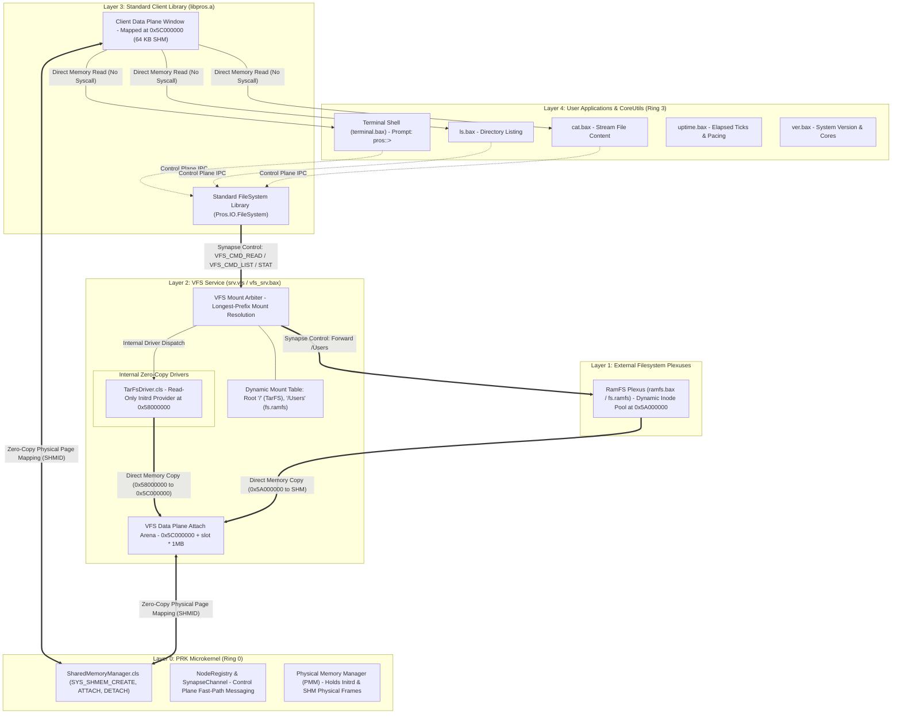

# PROS (Personal Research Operating System) Architecture Specification
## Microkernel Core, PID 1 Genesis Init, Userspace Driver Pipeline, and Display Compositor

```
 ┌────────────────────────────────────────────────────────────────────────────────────────┐
 │                              PROS SYSTEM OVERVIEW                                      │
 │                                                                                        │
 │   Kernel Identity : PRK-LLB (Personal Research Kernel in Low-Level BASIC)              │
 │   System Identity : PROS (Personal Research Operating System)                          │
 │   Executable Type : .bax (Basic Application eXecutable) / NEO/PE-BAX                   │
 │   IPC Primitives  : Dual-Plane Neural Synapse Channels & Shared Memory Gradients       │
 │   Design Paradigm : Pure Microkernel with Userspace Device Drivers & Compositor        │
 └────────────────────────────────────────────────────────────────────────────────────────┘
```

---

## 1. System Philosophy & Conceptual Taxonomy

In alignment with the **Dual-Plane Neural Node Architecture** (*"Everything is a Node connected via Synaptic Channels"*), all operating system components are structured as autonomous, capability-authenticated Nodes exchanging messages across memory-speed channels:

| Traditional Concept | Windows NT Equivalent | Unix / Linux Equivalent | PROS / PRK-LLB Equivalent | Architecture & Lifecycle Role |
|:---|:---|:---|:---|:---|
| **PID 1 (Init)** | `smss.exe` / `wininit` | `/sbin/init`, `systemd` | **`genesis.bax`** | **The Primary Life Pulse (PID 1):** Root orchestrator; stages boot and spawns core services. |
| **VFS Mount Arbiter** | `fltmgr` / File System | VFS Subsystem | **`vfs_srv.bax`** | **Storage Host & VFS Arbiter:** In-process TarFS + dynamic RamFS mounting at `/Users`. |
| **Process Manager** | `csrss.exe` / Process Mgr | Process Subsystem | **`proc_mgr.bax`** | **Process & Node Lifecycle Supervisor:** Manages dynamic `.bax` spawning, PID/Node mappings, exit code reaping, synaptic handle grants. |
| **Service Supervisor** | SCM (`services.exe`) | `systemd`, `launchd` | **`plexus_mgr.bax`** | **Service Supervisor:** Background daemon manager, health heartbeats, and restarts from `services.cfg`. |
| **Device Arbiter** | Plug & Play (`pnp_mgr`)| `udev`, `devd` | **`dev_mgr.bax`** | **Device Arbiter:** Hardware bus scanner (PCI/ACPI); signals `plexus_mgr` to summon drivers. |
| **Display Port Server**| Graphics Port (`dxgkrnl.sys`) | DRM Core / KMS Subsystem | **`disp_srv.bax`** | **Display Port Service:** System-wide display multiplexer; dynamically binds active driver daemon node and exposes clean presentation/cursor API. |
| **Display Driver Daemons** | Display Miniport (`nvlddmkm`, `igdkmd`) | DRM Drivers (`i915`, `amdgpu`, `bochs`) | **`drv.disp.*.bax`** | **Isolated Driver Daemons:** Independent Ring 3 processes (`svga_drv.bax`, `virtio_drv.bax`, `lfb_drv.bax`) executing GPU MMIO and hardware cursors. |
| **Display Compositor** | DWM (`dwm.exe`) | Wayland Compositor | **`compositor.bax`** | **Direct Compositor Engine:** Multi-window dirty rect blitter, 60 FPS hardware cursor overlay, frame pacing. |
| **Window Manager** | Windows Shell / Explorer | Mutter / KWin / Sway | **`wm.bax`** | **Window Manager:** Window decorations, titlebars, layouts, z-order stacking, focus routing. |
| **Raw Input Driver** | Kernel Input Subsystem | `evdev` / Kernel HID | **`input_srv.bax`** | **Unified Input Driver:** Reads PS/2 & USB keyboard/mouse, emits high-level Axon input packets. |
| **Power Manager** | `popmgr.sys` | `systemd-logind` | **`power_mgr.bax`** | **Power & Thermal Manager:** ACPI sleep states (S0–S5), poweroff, system reboot, CPU throttling. |
| **Network Plexus** | `tcpip.sys` / Winsock | Network Stack | **`net_srv.bax`** | **Network Plexus:** Ethernet driver binding (virtio-net, e1000), ARP/IP/TCP/UDP packet streams. |
| **Audio Plexus** | Audio Endpoint Srv | PulseAudio / PipeWire | **`audio_srv.bax`** | **Audio Plexus:** Intel HDA / AC97 audio frame DMA, sound buffer mixing across synapses. |

---

## 2. Complete End-to-End System Topology

```
 ┌────────────────────────────────────────────────────────────────────────────────────────┐
 │                                   USERSPACE (Ring 3)                                   │
 │                                                                                        │
 │  ┌──────────────────────────────────────────────────────────────────────────────────┐  │
 │  │                         GENESIS ORCHESTRATOR (PID 1)                             │  │
 │  │      - Inspects /System/Configurations/services.cfg                              │  │
 │  │        via Memory-Mapped Resource at 0x50000000                                  │  │
 │  │      - Spawns Core Service Managers & Establishes Initial Control Plane          │  │
 │  └───────────────┬──────────────────────────────────────────────────┬───────────────┘  │
 │                  │                                                  │                  │
 │                  ▼                                                  ▼                  │
 │  ┌───────────────────────────────┐                  ┌───────────────────────────────┐  │
 │  │          dev_mgr.bax          │                  │        plexus_mgr.bax         │  │
 │  │       (Device Arbiter)        │                  │       (Service Manager)       │  │
 │  │ - Scans ACPI & PCI Buses      │                  │ - Background service monitor  │  │
 │  │ - Matches Driver Manifests    │                  │ - Heartbeat telemetry probes  │  │
 │  │ - Hot-reloads crashed drivers │                  │ - Clean service restarting    │  │
 │  └───────────────┬───────────────┘                  └───────────────┬───────────────┘  │
 │                  │                                                  │                  │
 │                  ▼                                                  ▼                  │
 │  ┌───────────────────────────────┐                  ┌───────────────────────────────┐  │
 │  │        input_srv.bax          │                  │         vfs_srv.bax           │  │
 │  │    (Unified Input Driver)     │                  │  (VFS Arbiter & TarFS Host)   │  │
 │  │ - Reads raw scancodes & mouse │                  │ - Dynamic Mount Table (/)     │  │
 │  │ - Emits high-level InputEvents│                  │ - Routes to fs.ramfs Plexus   │  │
 │  └───────────────┬───────────────┘                  └───────────────┬───────────────┘  │
 │                  │                                                  │                  │
 │                  │ Axon Input Events (Key/Mouse)                    │ File I/O Synapse │
 │                  ▼                                                  ▼                  │
 │  ┌──────────────────────────────────────────────────────────────────────────────────┐  │
 │  │                              wm.bax (Window Manager)                             │  │
 │  │  - Manages Window Hierarchies, Focus State, Window Decorations & Titlebars       │  │
 │  │  - Routes Input Events to Active Focused Application Node                        │  │
 │  └───────────────┬──────────────────────────────────────────────────┬───────────────┘  │
 │                  │ Window Surface Grants                            │ Focus / Events   │
 │                  ▼                                                  ▼                  │
 │  ┌───────────────────────────────┐                  ┌───────────────────────────────┐  │
 │  │        compositor.bax         │                  │      Client Applications      │  │
 │  │  (Display Engine & Cursor)    │ <══════════════> │   (user_app.bax, calc.bax)    │  │
 │  │ - Multi-backend composition   │  Shared Memory   │ - Allocates client backbuffer │  │
 │  │ - Renders Hardware Cursor     │  (Zero-Copy)     │ - Draws UI widgets            │  │
 │  │ - Sends frame to disp_srv     │                  │ - Exchanges Synapse packets   │  │
 │  └───────────────┬───────────────┘                  └───────────────────────────────┘  │
 │                  │ Display Port API (PresentRect / SetCursor)                          │
 │                  ▼                                                                     │
 │  ┌───────────────────────────────┐                                                     │
 │  │         disp_srv.bax          │                                                     │
 │  │     (Display Port Server)     │                                                     │
 │  │ - System-wide display mux     │                                                     │
 │  │ - Binds to active driver node │                                                     │
 │  └───────────────┬───────────────┘                                                     │
 │                  │ Standard Driver Protocol (IDisplayDriver)                           │
 │                  ▼                                                                     │
 │  ┌────────────────────────────────────────────────────────┐                            │
 │  │        Isolated Userspace Display Driver Daemons       │                            │
 │  │  • svga_drv.bax   (VMware SVGA-II Hardware FIFO)       │                            │
 │  │  • virtio_drv.bax (VirtIO-GPU Paravirtualized 2D)      │                            │
 │  │  • lfb_drv.bax    (Generic Linear Framebuffer)         │                            │
 │  │  • i915_drv.bax   (Intel HD/UHD Graphics Driver)       │                            │
 │  └───────────────┬────────────────────────────────────────┘                            │
 └──────────────────┼─────────────────────────────────────────────────────────────────────┘
════════════════════╪══════════════════════════════════════════════════════════════════════
                    │ System Calls: SYS_SHMEM_* / SYS_SYNAPSE_* / SYS_NODE_*               
                    ▼                                                                      
 ┌────────────────────────────────────────────────────────────────────────────────────────┐
 │                                  PRK-LLB MICROKERNEL (Ring 0)                          │
 │                                                                                        │
 │  ┌──────────────────────────────────────┐    ┌──────────────────────────────────────┐  │
 │  │      Hardware Trap & MMIO Engine     │    │       Memory Management Subsystem    │  │
 │  │ - PS/2 Controller IRQ1 (Scancodes)   │    │ - PMM (Physical Free-List Allocator) │  │
 │  │ - PS/2 Mouse IRQ12 (3-Byte Packets)  │    │ - Binary Buddy Allocator (Order 0-10)│  │
 │  │ - Publishes directly to raw Node #2  │    │ - 4-Level VMM (Isolated User PML4s)  │  │
 │  │   ('hw.input.raw') via Ring Buffers  │    │ - Shared Memory Gradients (SHMEM)    │  │
 │  └──────────────────────────────────────┘    └──────────────────────────────────────┘  │
 │                                                                                        │
 │  ┌──────────────────────────────────────┐    ┌──────────────────────────────────────┐  │
 │  │      SMP Runqueue Scheduler Engine   │    │     Dual-Plane Neural Node Registry  │  │
 │  │ - Per-CPU Circular Runqueues         │    │ - Node Descriptor Lifecycle Storage  │  │
 │  │ - Work-Stealing across SMP Cores     │    │ - Lock-Free Axonal Fast-Path Rings   │  │
 │  │ - Fast LSTAR MSR Syscall Gate        │    │ - Capability Authentication Engine   │  │
 │  └──────────────────────────────────────┘    └──────────────────────────────────────┘  │
 └────────────────────────────────────────────────────────────────────────────────────────┘
```

---

## 3. Bootstrap & Biological Genesis Boot Sequence

```
 ┌────────────────────────────────────────────────────────────────────────────────────────┐
 │                    BIOLOGICAL GENESIS BOOT HIERARCHY & SEQUENCE                        │
 │                                                                                        │
 │   Microkernel Core Bring-up (Ring 0: PRK-LLB)                                          │
 │   - Loads kernel.elf at 1MB, sets up Long Mode (x86_64), GDT, TSS, IDT, LAPIC/IO-APIC. │
 │   - Initializes PMM, Buddy Allocator, VMM, and Kernel Heap (8MB).                      │
 │   - Relocates initrd.tar to physical memory (0x6000000 / 96MB).                        │
 │   - Boots all AP cores sequentially; enables LSTAR Fast Syscalls & Node Registry.      │
 │   - Microkernel spawns Genesis (PID 1) with boot payload, transitioning to userspace.  │
 │                                                                                        │
 │   Stage 1: Storage & Process Foundation                                                │
 │   - genesis.bax (PID 1) launches and inspects embedded configuration.                  │
 │   - Spawns vfs_srv.bax (Storage Arbiter): Mounts TarFS (X:\) and dynamic RamFS.        │
 │   - Spawns proc_mgr.bax: Process & Node Lifecycle Supervisor for dynamic execution.   │
 │                                                                                        │
 │   Stage 2: Sensory-Motor Hardware Bring-up                                             │
 │   - genesis.bax signals dev_mgr.bax (Device Arbiter) to scan ACPI & PCI buses.         │
 │   - dev_mgr.bax coordinates with plexus_mgr.bax (Service Supervisor).                  │
 │   - Launches disp_srv.bax (Display Driver Service) to claim VRAM aperture.             │
 │   - Launches input_srv.bax (Unified Input Driver) to bind PS/2 & USB keyboard/mouse.   │
 │                                                                                        │
 │   Stage 3: Visual Workstation & Applications                                           │
 │   - Launches compositor.bax: 60 FPS frame-paced multi-window compositor engine.       │
 │   - Launches wm.bax: Window Manager for window frames, decorations, hit-testing.       │
 │   - Launches Desktop Workspace (SysMon, Apps) and terminal.bax (Interactive Shell).   │
 │   - Userspace processes dynamically spawned via SYS_PROCESS_SPAWN (10) from PATH.      │
 └────────────────────────────────────────────────────────────────────────────────────────┘
```

---

## 4. Subsystem Details & Responsibilities

### A. PID 1 Orchestrator: `genesis.bax`
- **Minimal Core:** Unlike monolithic Unix `systemd`, `genesis.bax` does not contain loggers, network managers, or DNS resolvers. It is purely an orchestrator.
- **Fault Recovery:** Maintains supervision over the Big Four managers. If `compositor.bax` or `dev_mgr.bax` crashes, the microkernel reaps the terminated PID and notifies `genesis.bax`, which immediately restarts the service.

### B. Device & Driver Arbiter: `dev_mgr.bax`
- **Bus Scanning:** Enumerates PCI configuration space (`0xCF8`/`0xCFC`) and ACPI tables.
- **Manifest Matching:** Inspects `.bax` binaries in the system directory for matching hardware signatures:
  ```json
  {
    "app_id": "sys.driver.bga",
    "kind": "driver",
    "matches": [
      { "bus": "pci", "vendor": "0x1234", "device": "0x1111" }
    ],
    "capabilities": ["CAP_FRAMEBUFFER_MAP", "CAP_PCI_CONFIG"]
  }
  ```
- **Driver Process Isolation:** Drivers run with restricted user privileges. A buggy GPU or network driver cannot corrupt kernel page tables.

### C. Service Supervisor: `plexus_mgr.bax`
- **Heartbeat Synapses:** Services connect a dedicated control-plane synapse channel to `plexus_mgr.bax`.
- **Health Probing:** Services emit periodic heartbeat tokens. If a service becomes unresponsive or deadlocks, `plexus_mgr.bax` terminates and respawns it.

### D. Input Service: `input_srv.bax`
- **Kernel Input Decoupling:** The microkernel's IRQ1 (Keyboard) and IRQ12 (Mouse) handlers only copy raw bytes into the lock-free ring buffer of `Node #2` (`hw.input.raw`).
- **Stateful Decoding in Userspace:**
  - `input_srv.bax` translates raw scancodes into UTF-8 characters and virtual keycodes.
  - Assembles 3-byte PS/2 mouse packets, calculates relative $\Delta X$ and $\Delta Y$, clamps mouse coordinates to screen boundaries (`0..1023`, `0..767`), and tracks button state changes.
  - Emits high-level, capability-authenticated `InputEvent` packets to `wm.bax` and `compositor.bax`.

### E. Display Compositor & Window Manager: `compositor.bax` & `wm.bax`
- **Zero-Copy Surface Composition:**
  - Client applications allocate their window canvas using `SYS_SHMEM_CREATE`.
  - The compositor maps the client's canvas via `SYS_SHMEM_MAP` without data copying.
  - The compositor renders the final scene into the double-buffered Linear Framebuffer (`0xFD000000`).
- **Tear-Free Hardware Cursor Overlay:**
  - The cursor is rendered on an independent overlay plane, redrawing only dirty rectangles when the mouse moves.

---

## 5. Foundational Kernel Primitives (Completed)

The microkernel core provides the essential hardware abstractions and IPC primitives required for userspace drivers and graphical services:

1. **Zero-Copy Shared Memory (`SharedMemoryManager.cls`):**
   - Allocates contiguous physical memory frames on demand via the binary Buddy Allocator.
   - Maps identical physical pages into multiple User PML4 page tables (`PTE_PRESENT | PTE_WRITABLE | PTE_USER`).
   - Supports both explicit virtual address placement (`targetVaddr != 0`) and automatic ASLR entropy generation (`targetVaddr = 0`) within the `0x58000000..0x6E000000` arena.
   - Reference-counted lifecycle: frames are zeroed prior to mapping to prevent information disclosure, and automatically returned to the Buddy pool when all attached processes detach.
   - Syscalls: `SYS_SHMEM_CREATE` (60), `SYS_SHMEM_ATTACH` (61), `SYS_SHMEM_DETACH` (62).

2. **Peer-to-Peer Userspace Synapse Discovery (`NodeRegistry.cls`):**
   - Syscall `SYS_NODE_LOOKUP` (55) allows userspace processes to dynamically discover registered Nodes by name (e.g. `'hw.input.raw'`, `'srv.input'`).
   - Syscall `SYS_SYNAPSE_CONNECT` (51) authenticates capability bitmasks (`CAP_SYNAPSE_READ`, `CAP_SYNAPSE_WRITE`) and instantiates bidirectional lock-free ring buffers between nodes.

3. **Hardware Input Decoupling & PS/2 Mouse Capture (`Mouse.cls`):**
   - Microkernel captures PS/2 keyboard (IRQ 1) and PS/2 auxiliary mouse (IRQ 12).
   - I/O APIC routes IRQ 12 to Vector 44; IDT Gate 44 triggers ISR callback.
   - 3-byte packet assembly state machine with bit-3 alignment validation and hardware sign-bit extension (bits 4 and 5).
   - Lock-free Structure of Arrays (SoA) raw ring buffer.
   - Registered as Node `#1002` (`hw.input.raw`) for userspace driver consumption.

4. **Unified Input Driver Daemon (`services/input_srv/`):**
   - Standalone Ring 3 process (`input_srv.bax`) bundled inside the USTAR ramdisk (`initrd.tar`).
   - Registers Node `#1004` (`srv.input`), subscribes to `hw.input.raw` via Synapse Channel `#5002`.
   - Allocates an 8 KB zero-copy shared memory event gradient (`SharedInputQueue` / `INPUT_QUEUE_MAGIC`) mapped at `0x60000000` with 64 high-level event slots (`EVENT_KEY_DOWN`, `EVENT_KEY_UP`, `EVENT_MOUSE_MOVE`, `EVENT_MOUSE_BUTTON`).

---

## 6. Graphics Display Subsystem & Compositor Pipeline

```
 ┌────────────────────────────────────────────────────────────────────────┐
 │                        GUI Applications & Clients                      │
 │                  (Draws into private shared surface)                   │
 └───────────────────────────────────┬────────────────────────────────────┘
                                     │ Surface Handle (SHMEM)
                                     ▼
 ┌────────────────────────────────────────────────────────────────────────┐
 │                        COMPOSITOR (compositor.bax)                     │
 │  - Window hierarchy & stacking order (Z-order)                         │
 │  - Alpha blending, shadows, window decorations (WM)                    │
 │  - Cursor composition & damage/dirty-rect tracking                     │
 │                                                                        │
 │   ┌────────────────────────────────────────────────────────────────┐   │
 │   │                    Pluggable Render Backends                   │   │
 │   │   [Software / CPU]     [Vulkan]     [OpenGL]     [SDL Host]    │   │
 │   └────────────────────────────────┬───────────────────────────────┘   │
 └────────────────────────────────────┼───────────────────────────────────┘
                                      │ Display API (Scanout / Flip)
                                      ▼
 ┌────────────────────────────────────────────────────────────────────────┐
 │                     DISPLAY SERVER (disp_srv.bax)                      │
 │                 "The Hardware Graphics Arbiter / HAL"                  │
 │                                                                        │
 │  - Mode setting (resolutions, refresh rates, BPP)                      │
 │  - Scanout buffer allocation & Page-Flip synchronization (VSYNC)       │
 │  - Driver multiplexer / plugin manager:                                │
 │      ├─ Generic Linear Framebuffer (VGA/BGA/UEFI GOP) [Current]        │
 │      ├─ VirtIO-GPU / Bochs VBE                                         │
 │      └─ Intel HD/UHD, AMD Radeon, NVIDIA Nouveau (Future)              │
 └────────────────────────────────────┬───────────────────────────────────┘
                                      │ Microkernel MMIO / DMA Synapse
                                      ▼
                          PRK-LLB Microkernel Core
```

### A. Display Server (`disp_srv.bax`)
- Acts as the hardware abstraction layer (HAL) for display devices.
- Directs hardware access (MMIO aperture `0xFD000000`, 1024x768x32bpp, pitch 4096).
- Manages scanout double-buffering and page-flip synchronization.
- Exposes standard Display Server API to the compositor:
  - `AllocateScanoutBuffer()`
  - `SetMode(width, height, bpp)`
  - `FlipBuffer()`
  - `SetHardwareCursor()`

### B. Backend-Agnostic Compositor (`compositor.bax`)
- Implements `compositor_backend_t` abstraction matching PRK reference:
  - `init()`
  - `surface_create(surf, width, height)`
  - `surface_destroy(surf)`
  - `surface_present(surf, x, y)`
  - `surface_update(surf, x, y, dirty_x, dirty_y, dirty_w, dirty_h)`
  - `surface_fill_rect(...)`
  - `surface_draw_text(...)`
  - `shutdown()`
- Backends supported:
  1. `fb.c` (Linear Framebuffer / CPU Software Rasterizer)
  2. `opengl.c` (OpenGL / GLES Acceleration)
  3. `vulkan.c` (Vulkan Acceleration)
  4. `sdl.c` (Workstation Hosted Simulation)
- **Zero-Copy In-RAM Backbuffering:**
  - Ring 3 Compositor allocates private in-RAM backbuffer (`backSurf`) at virtual address `0x88000000` via `AllocatePages` (`SYS_MEM_ALLOC_PAGES`).
  - All sprite rasterization, cursor background saving/restoring, and text rendering are performed directly in cached System RAM at CPU L1/L2 speeds.
  - Completely eliminates uncached PCIe non-posted reads across the bus during mouse movement.
- **Direct 64-Bit Aligned Dirty Rectangle Burst Blit (`FlushDirtyRegion`):**
  - Maintains bounding box damage tracking to flush only active dirty rectangles to the physical VRAM aperture (`0x78000000`) using 64-bit aligned memory writes and `sfence` barriers.
- Renders software mouse cursor overlay (16x18 PRK arrow) on top of composite frames without tearing or bus stalls.

### C. Default GUI Theme Specification (Nord / Dark Palette)
Matches PRK reference implementation:
- **Base Background:** Deep Dark (`0xFF191D24` / `0xFF232731`)
- **Title Bar:** Charcoal Slate (`0xFF2E3440`), Height: 28px
- **Accent Line:** Cyan Accent Border (`0xFF56B6C2` / `0xFF88C0D0`), Height: 1px below title bar
- **Title Text:** Monospaced 8x16 font (`0xFFD8DEE9`)
- **Window Controls (Top-Right):**
  - **Minimize (`-`):** Slate Blue (`#5E81AC` / `0xFF5E81AC`)
  - **Maximize (`+`):** Emerald Green (`#00C853` / `0xFFA3BE8C`)
  - **Close (`X`):** Crimson Red (`#BF616A` / `0xFFBF616A`)

---

## 7. Standard System Runtime Library (`lib/pros`)

To prevent code duplication across userland services and applications, PROS provides a centralized system library `lib/pros`:

```
lib/pros/
├── ProsSys.bas        ' Process.Yield(), Process.GetPid(), Process.Exit(), Process.Sleep()
├── ProsConsole.bas    ' Console.Print(), Console.PrintF() (SprintF integration)
├── ProsNode.bas       ' Node.Register(), Node.Lookup(), Synapse.Connect(), Synapse.Push(), Synapse.Pop()
├── ProsShmem.bas      ' Shmem.Create(), Shmem.Attach(), Shmem.Detach()
├── ProsInput.bas      ' InputEvent, SharedInputQueue reader
└── ProsGui.bas        ' Window, Surface, and Compositor IPC client primitives
```

All userland projects (`.llbproj`) link against `lib/pros` to utilize clean, type-safe Low-Level Basic procedures instead of raw inline assembly syscalls.

---

## 8. Dynamic Linking & Shared Library Architecture (`libpros.bdl` & `ld.bax`)

### A. Motivation & Footprint Optimization
In early bootstrap phases, services and test applications link against `lib/pros` statically. As the operating system scales to hundreds of system services, shell utilities, and graphical user applications, static duplication of runtime routines inflates binary size and wastes physical memory.

To eliminate this overhead, PROS introduces native dynamic linking via **Basic Dynamic Libraries (`.bdl`)** and the userspace dynamic loader **`ld.bax`**.

```
                  ┌─────────────────────────────────────────┐
                  │          Microkernel BaxLoader          │
                  └────────────────────┬────────────────────┘
                                       │ Maps App & Dynamic Linker
                                       ▼
┌─────────────────────────────────────────────────────────────────────────────────┐
│                          Process Address Space (User PML4)                      │
│                                                                                 │
│   0x40000000: [ Application Binary (.bax) ]                                     │
│               - Contains Import Directory Table (List of needed libraries)      │
│               - Jump stubs point to Import Address Table (IAT)                  │
│                                                                                 │
│   0x70000000: [ Shared System Library: libpros.bdl ]                            │
│               - Text/code pages are mapped READ-ONLY from shared physical PMM   │
│               - 100 processes running libpros consume ZERO duplicate RAM!       │
│                                                                                 │
│   0x7F000000: [ Dynamic Linker Runtime: ld.bax ]                                │
│               - Resolves symbol addresses into application's IAT                │
│               - Jumps to application's actual user_main()                       │
└─────────────────────────────────────────────────────────────────────────────────┘
```

### B. Format Specification: `.bdl` (Basic Dynamic Library)
- Uses the standard `BaxHeader` structure with `Header.Flags = BAX_FLAG_SHARED_LIB` (`0x0002`).
- **Export Directory Table:** Contains exported symbol names/hashes and relative virtual offsets (RVA).
- **Import Directory Table:** Embedded within `.bax` binaries, declaring required libraries (`libpros.bdl`) and imported function names.

### C. Zero-Copy Shared Text Pages
- Because PROS features `SharedMemoryManager` and PMM page table manipulation, the code (`.text`) and read-only data (`.rodata`) segments of `libpros.bdl` are allocated in physical RAM exactly **once**.
- When any process launches, the kernel or dynamic loader maps these existing physical frames into the process's User PML4 at `0x70000000` with read-only/executable permissions (`PTE_PRESENT | PTE_USER`).
- **Impact:** Individual `.bax` binary sizes shrink from ~8–12 KB to ~500 bytes – 1 KB, and system-wide RAM consumption for standard libraries is reduced to a single shared physical instance.

### D. Implementation Timeline
- **Phase 14:** Modular static `lib/pros` library establishing clean namespace APIs (`Pros.Sys`, `Pros.IO`, `Pros.Nodes`, `Pros.Memory`, `Pros.Gui`).
- **Phase 15 (Current - REV: 2026.10.30-r38-re10):** Dual-Plane Virtual File System (VFS), Zero-Copy Shared Memory Data Plane streaming (`0x66000000`), TarFS & RamFS hybrid mounting, CoreUtils (`cat`, `ls`), and SMP-reliable shell directory navigation.
- **Phase 16:** Implementation of `ld.bax` dynamic loader runtime and compilation of `libpros.bdl`. All userland applications transition from static linking to dynamic linking without changing any API calls.

---

## 11. Dual-Plane Storage Subsystem & Zero-Copy Shared Memory Streaming

### 11.1 Architectural Model & Topology
The Personal Research Operating System (PRK-OS / PROS) implements a strict **Dual-Plane Architecture** for all file storage, directory resolution, and data transfer:
- **Control Plane (Synapse IPC):** Lightweight, fixed 256-byte `AxonPacket` messages used solely for command signaling, metadata negotiation (`STAT`), capability verification, and session control (`VFS_CMD_READ`, `VFS_CMD_LIST`).
- **Data Plane (Zero-Copy Shared Memory):** Bulk file content and complete directory listings stream across 64 KB shared physical frame windows mapped at virtual address `0x5C000000` via microkernel `SharedMemoryManager` (`SYS_SHMEM_CREATE` and `SYS_SHMEM_ATTACH`), achieving memory-bandwidth transfer speeds (>10 GB/s) with zero syscall overhead per byte.



### 11.2 Directory Navigation & IPC Reliability
To ensure deterministic directory traversal (`cd`, `ls`) across SMP multicore configurations:
1. **Bounded Synchronous Waiting (`SynapsePopResponse`):** Client IPC exchanges utilize a bounded polling loop with `Process.Sleep 5` up to 500ms, replacing the fragile 10-yield loop and guaranteeing response arrival even under heavy SMP scheduling contention.
2. **Monotonic Sequence Matching:** Client requests embed an advancing transaction sequence number (`g_clientSeq`). Late or stale packets from aborted transactions are discarded immediately, preventing mailbox poisoning and cascading deserialization failures.
3. **Plexus Forwarding Channel Isolation:** VFS requests forwarded to external storage plexuses (e.g. `fs.ramfs` for `/Users`) block specifically on the forward synapse channel (`fwdChan >= 5000`) rather than multiplexing on the root `srv.vfs` node listener, eliminating packet interception between concurrent client tasks.

---

## 12. Dynamic Process Lifecycle & Neural Node Execution

### 12.1 Microkernel Dynamic Process Subsystem
To facilitate dynamic process loading and child execution without monolithic fork semantics, PRK-OS introduces a capability-oriented Dual-Plane process execution model via Syscall 10 (`SYS_PROCESS_SPAWN`) and Syscall 11 (`SYS_PROCESS_WAIT`).

#### Syscall 10: `SYS_PROCESS_SPAWN`
- **Register Conventions:**
  - `%rdi` (sysNum): `10`
  - `%rsi` (arg1): `namePtr` (Pointer to null-terminated ASCII process name, e.g. `"cat"`)
  - `%rdx` (arg2): `shmId` (Shared memory identifier containing the executable `.bax` binary stream)
  - `%rcx` (arg3): `argc` (Number of command-line arguments)
  - `%r8`  (arg4): `argvPtr` (User virtual address pointing to argument string pointers)
  - `%r9`  (arg5): `priority` (Process scheduling priority, 0 = normal user priority)
- **Kernel Execution Flow:**
  1. **User PML4 Allocation:** `VMM.CreateUserPml4()` constructs an isolated 4-level page table hierarchy with kernel space higher-half mirror (`0xFFFF800000000000`) and Ring 3 user space.
  2. **Binary Materialization:** Resolves physical frames from `SharedMemoryManager` backing `shmId`, loads binary code and data segments via `BaxLoader.LoadBinary` mapped starting at virtual address `0x40000000`.
  3. **User Stack Allocation:** Allocates and maps 4 contiguous physical pages for user stack up to virtual boundary `0x78000000` (top of `PDPT[1]`).
  4. **Neural Node Enrollment:** Registers a unique node identifier in `NodeRegistry` formatted as `<basename>.<pid>` (e.g. `cat.12`), ensuring global routing isolation.
  5. **Startup Context Construction:** Materializes a `NodeStartupContext` structure at the top of the user stack (`0x77FFFF80`), pre-wiring default parent-child Synapse channels.
  6. **Synthetic Stack & Register State:** Prepares initial execution context with `%rdi = argc`, `%rsi = argvPtr`, `%rdx = Pointer To NodeStartupContext`, and initial `userRsp = 0x77FFFE60` strictly below `NodeStartupContext` and argument buffers, placing entry IP at the loaded `.bax` entrypoint and enqueuing the `TaskControlBlock` in `Scheduler`.

#### Syscall 11: `SYS_PROCESS_WAIT`
- **Register Conventions:**
  - `%rdi` (sysNum): `11`
  - `%rsi` (arg1): `targetPid` (Process ID to await, or `0` for any child)
  - `%rdx` (arg2): `outExitCodePtr` (User virtual pointer to receive `UInt32` exit status)
  - `%rcx` (arg3): `flags` (`0` = blocking wait until child exits, `1` = non-blocking poll)
- **Exit Status Protocol:**
  - When tasks invoke `ExitCurrentTask(exitCode)`, the scheduler caches `(PID, exitCode)` in an exited process ring buffer.
  - Blocking wait yields the calling thread (`ProcessYield`) until the child status is collected.
  - Returns `0` on success, `1` if process is still active (non-blocking poll), or negative error code if PID is invalid.

### 12.2 `NodeStartupContext` Protocol
Every dynamic process instantiated via `SYS_PROCESS_SPAWN` receives an architectural handover context at the top of its stack page (`0x77FFFF80`), safely segregated above the downward-growing execution stack (`userRsp = 0x77FFFE60`):
```vb
<Packed>
Public Structure NodeStartupContext
    Public NodeId          As NodeId          ' Global Node ID registered in NodeRegistry
    Public ProcessId       As ProcessId       ' Child Process ID (PID)
    Public ParentPid       As ProcessId       ' Parent Process ID (caller PID)
    Public InboundSynapse  As SynapseId       ' Pre-wired Inbound Synapse channel (e.g. STDIN pipe)
    Public OutboundSynapse As SynapseId       ' Pre-wired Outbound Synapse channel (e.g. STDOUT TTY channel)
    Public ErrorSynapse    As SynapseId       ' Pre-wired Error Synapse channel (e.g. STDERR channel)
    Public Argc            As UInt64          ' Argument count
    Public Argv            As VirtualAddress  ' Child virtual address of argv pointer array
    Public NodeName(31)    As Byte            ' Null-terminated unique node identifier
End Structure
```
During runtime entry in `lib/runtime/brt0.S`, register `%rdx` is checked for non-zero (pointing to `NodeStartupContext` at `0x77FFFF80`). If present, `brt0.S` reads `OutboundSynapse` from `32(%rdx)`. If non-zero, the runtime invokes `Pros_IO_Console_SetTtyChannel(OutboundSynapse)`, seamlessly directing standard console output (`ConsoleWriteLine`) to the summoning parent terminal screen via `MSG_TTY_WRITE` Synapse packets.

### 12.3 Hypervisor Frame Pacing & Compositor Scheduling
To eliminate CPU spinning and APIC timer jitter on hypervisors such as VirtualBox:
- The compositor event loop enforces an unconditional yield/sleep invariant across all execution paths.
- When the frame deadline has not yet arrived (`nextFrameTime > nowTime`), the compositor sleeps for the remaining delta or yields.
- When the frame deadline has already elapsed (`nextFrameTime <= nowTime`), the compositor sets `nextFrameTime = nowTime + 16` and explicitly executes `ProcessYield`, preventing continuous 100% core spin and allowing background processes, input drivers, and terminal shells to obtain execution slices deterministically.
- Mouse cursor updates are segregated into dirty rect clears and coordinate updates (~11 KB blit) rather than full frame transfers (1.8 MB), sustaining 60 FPS presentation even under heavy CPU virtualization.

### 12.4 Fine-Grained SMP Per-CPU Runqueues & Work-Stealing Protocol
To eliminate cross-core lock contention and spinlock-holder preemption stalls on hypervisors (VirtualBox, QEMU, bare metal):
- The microkernel scheduler replaces the monolithic `schedLock` with fine-grained per-CPU runqueue spinlocks (`coreLocks(16)`).
- **Steal Arbitration Protocol:** Cross-core load balancing uses an isolated `stealLock`. During work-stealing, an idle core acquires `stealLock`, inspects candidate core runqueues, and locks only the victim core's `coreLocks(victimCpu)` before migrating a ready task.
- **Global State Isolation:** Process termination (`ExitCurrentTask`) and exit code collection (`GetProcessExitStatus`) use a dedicated `schedGlobalLock` to protect the exited task ring buffer, decoupling process lifecycle management from per-core task scheduling.

### 12.5 Hardware Framebuffer Write-Combining (IA32_PAT MSR 0x277)
To resolve EPT violation storms and memory bus bottlenecks during VRAM rendering:
- The BSP and all AP cores configure the `IA32_PAT` MSR (0x277) with `PAT_CONFIG = 0x0007040600070106`, programming PAT PA1 as Write-Combining (`0x01`).
- During physical-to-virtual framebuffer mapping (`SYS_FB_MAP`), PTE flags are set to `0x0F` (Present | Writable | User | Page-level Write-Through `PWT`), routing all VRAM writes directly to processor Write-Combining burst buffers.
- Eliminates uncacheable (UC) bus locking and allows 1024x768x32 ARGB burst fills to run at wire speed across VirtualBox, WHPX, KVM, and bare metal hardware.

### 12.6 Native Low-Level Basic BAX Packager (`tools/bax_pack`)
To eliminate external runtime dependencies (such as Python), the BAX packaging toolchain is implemented purely in Low-Level Basic:
- **Project Structure:** `tools/bax_pack/BaxPack.llbproj` compiling `BaxPackMain.bas` into native ELF `build/bax_pack`.
- **Packaging Logic:** Directly parses ELF64 headers, extracts `.text`, `.rodata`, `.data`, and `.bss` segments, validates JSON manifests, calculates checksums, and serializes the complete Neural BAX container binary stream natively.
- Integrated into `tools/pack_initrd.sh` and `tools/rebuild_all.sh` as the primary production packager.

## 13. Unified Window Manager Input Event Routing Pipeline

### 13.1 Production Architecture & Focus Isolation
In production windowing systems (such as X11/Wayland and Windows Shell), user applications never poll raw hardware scancode buffers directly. Instead:
1. **Single Event Consumer (`srv.wm`):** The Window Manager daemon serves as the exclusive Ring 3 consumer of keyboard and mouse hardware events.
2. **Zero-Copy Lock-Free Event Routing:** `srv.wm` maintains a shared memory `WindowTable` containing dedicated, decoupled event queues (`Queues(16) As WindowEventQueue`).
3. **Strict Input Focus Confinement:** Keystrokes are directed exclusively to the active focused window (`focusedWinId`). Inactive windows receive zero events, preventing keystroke accumulation while running in the background.
4. **Focus Shift Queue Invalidation:** When focus shifts away from a window, its input queue is instantly cleared (`EventHead = EventTail`), preventing stale keystroke replay upon refocus.

### 13.2 Microkernel Syscall 21: `SYS_GET_KEY_EVENT`
To support accurate key state tracking, typematic repeat, and multi-key rollover:
- **Kernel PS/2 Scancode Decoder (`Keyboard.cls`):** Emits full `<Packed> Structure RawKeyEvent (Scancode As Byte, State As Byte, Ascii As Byte, Modifiers As Byte)` records.
- **Break Code Preservation:** The driver decodes both make codes (`State = 1`, KeyDown) and break codes (`State = 2`, KeyUp), preserving extended key flags (`0xE0` prefixes).
- **Syscall 21 Dispatch:** Returns the next `RawKeyEvent` non-blockingly to `srv.wm`, enabling true press-and-hold semantics for complex applications and real-time games.

### 13.3 Client Input Polling API (`WmPollEvent`)
Client GUI applications poll for incoming events from the shared memory table via `WmPollEvent`:
- **Constant-Time Direct Indexing:** Queues are indexed via `winId Mod 16`, eliminating table scanning loops and shielding the queue from window Z-order shifts or reordering.
- **Continuous Momentum in DOOM:** DOOM maintains continuous player momentum by receiving paired KeyDown and KeyUp events, keeping `gamekeydown[key_forward]` asserted throughout the movement period and eliminating stuttering or frame-to-frame velocity drops.

---

## 14. Demand Paging & Virtual Memory Area (#PF VMA Subsystem)

### 14.1 Microkernel Virtual Memory Area (VMA) Architecture
To support large memory consumers (such as DOOM's 6 MB zone allocator, software 3D rasterizers, and dynamic user applications) without depleting physical frames upfront or introducing process startup latency, the Personal Research Operating System (PROS / PRK-OS) implements a lightweight Virtual Memory Area (VMA) subsystem embedded directly into the microkernel `TaskControlBlock`:
- **Per-Process VMA Table:** Every task maintains an active table of up to 32 discrete `VmaEntry` descriptors:
  ```vb
  <Packed>
  Public Structure VmaEntry
      Public StartVaddr As UInt64          ' Page-aligned start virtual address
      Public EndVaddr   As UInt64          ' Page-aligned end virtual address (exclusive)
      Public Flags      As UInt32          ' Permissions (READ, WRITE, EXEC, ANON, LAZY)
      Public PageCount  As UInt32          ' Number of 4 KB pages in region
  End Structure
  ```
- **Contiguous VMA Coalescing:** When subsequent allocations are adjacent to an existing VMA with identical permission flags, `AddVma` merges them dynamically, keeping the VMA list compact and within $O(1)$ lookup thresholds.

### 14.2 O(1) Fast Lazy Page Allocation (Syscall 26: `SYS_MEM_ALLOC_PAGES`)
When a user process requests dynamic memory pages via Syscall 26:
- The microkernel validates the address bounds against `USER_SPACE_MAX` (`0x78000000`).
- Rather than synchronously committing physical frames from the `BuddyAllocator` and building page directory structures upfront, the microkernel registers a `VMA_LAZY` range in the calling task's VMA table in $O(1)$ time and immediately returns `reqVaddr`.
- Reduces process memory footprint to zero committed pages until memory is actually accessed.

### 14.3 Vector 14 (`#PF`) Page Fault Resolution & Physical Frame Commit
When a task accesses an uncommitted page in a `VMA_LAZY` region:
1. **Interrupt Vector 14 (`#PF`):** CPU triggers a page fault exception. The hardware pushes the error code and traps into `kernel/src/arch/x86_64/Idt.bas`.
2. **Fault Address Inspection:** The handler reads the faulting virtual address from processor register `CR2`.
3. **VMA Range Lookup:** `VmaOperations.FindVma` searches the active task's VMA table. If `CR2` falls within a registered `VMA_LAZY` area:
   - Verifies permissions (e.g. write fault on read-only VMA triggers clean task exit).
   - Dynamically allocates an order-0 (4 KB) physical frame from `BuddyAllocator`.
   - Zero-fills the newly allocated frame directly via identity-mapped kernel memory.
   - Maps the physical frame into the task's PML4 page tables (`VmmEngine.MapPage`) with user permissions (`PTE_PRESENT | PTE_USER` and optional `PTE_WRITABLE`).
   - Executes `invlpg` to flush the active CPU's TLB.
   - Transparently exits the ISR stub via `iretq`, which immediately re-executes the faulting instruction with zero application interruption.
4. **Fallback Guard for Stack Auto-Expansion:** Retains transparent auto-expansion for the downward-growing user execution stack region (`0x6C000000 .. 0x78000000`).
5. **Clean Process Teardown:** When a process exits, `VirtualMemoryManager.DestroyUserPml4` inspects page table entries and releases only frames with `PTE_PRESENT`, preventing physical frame leaks and ensuring uncommitted lazy pages consume zero physical memory.


