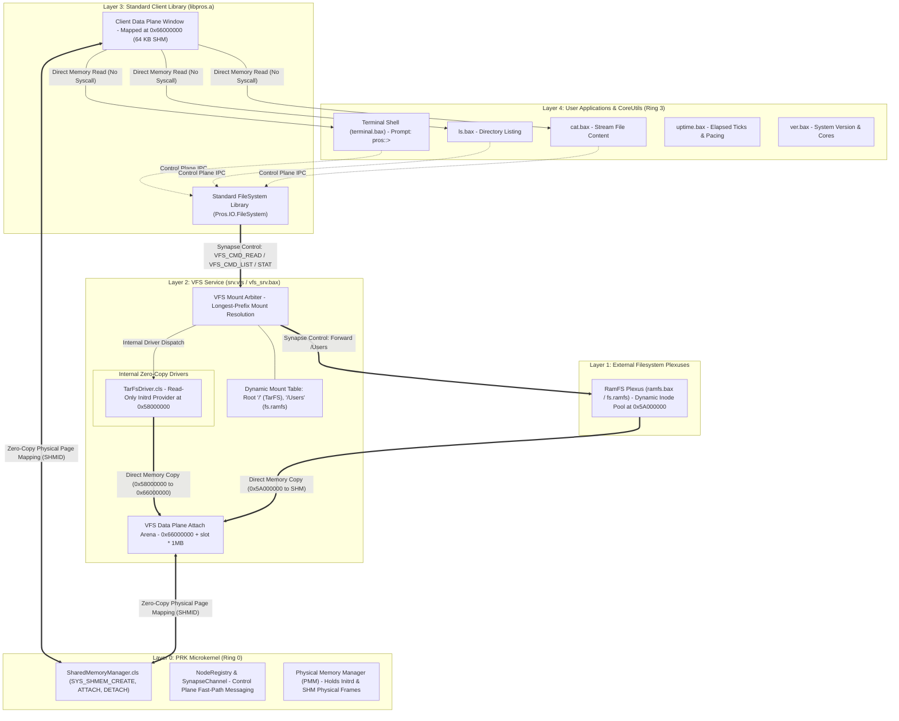

# PROS (Personal Research Operating System) Architecture Specification
## Microkernel Core, PID 1 Genesis Init, Userspace Driver Pipeline, and Display Compositor

```
 ┌────────────────────────────────────────────────────────────────────────────────────────┐
 │                              PROS SYSTEM OVERVIEW                                      │
 │                                                                                        │
 │   Kernel Identity : PRK-LLB (Personal Research Kernel in Low-Level BASIC)              │
 │   System Identity : PROS (Personal Research Operating System)                          │
 │   Executable Type : .bax (Basic Application eXecutable) / NEO/PE-BAX                   │
 │   IPC Primitives  : Dual-Plane Neural Synapse Channels & Shared Memory Gradients       │
 │   Design Paradigm : Pure Microkernel with Userspace Device Drivers & Compositor        │
 └────────────────────────────────────────────────────────────────────────────────────────┘
```

---

## 1. System Philosophy & Conceptual Taxonomy

In alignment with the **Dual-Plane Neural Node Architecture** (*"Everything is a Node connected via Synaptic Channels"*), all operating system components are structured as autonomous, capability-authenticated Nodes exchanging messages across memory-speed channels:

| Traditional Concept | Windows NT Equivalent | Unix / Linux Equivalent | PROS / PRK-LLB Equivalent | Architecture & Lifecycle Role |
|:---|:---|:---|:---|:---|
| **PID 1 (Init)** | `smss.exe` / `wininit` | `/sbin/init`, `systemd` | **`genesis.bax`** (or **`cortex.bax`**) | Root userspace coordinator spawned directly by microkernel. |
| **Process** | Process (`.exe`) | Process (ELF binary) | **Node Process** (`.bax`) | Hardware-isolated address space (User PML4) running one or more Nodes. |
| **System Service** | Windows Service | Daemon (`systemd` unit) | **Plexus Service** (`*.bax`) | Long-running background subsystem node (e.g., storage, networking). |
| **Service Supervisor** | SCM (`services.exe`) | `systemd`, `launchd` | **`plexus_mgr.bax`** | Oversees service lifecycles, health heartbeat synapses, and restarts. |
| **Device Arbiter** | Plug & Play (`pnp_mgr`)| `udev`, `devd` | **`dev_mgr.bax`** | Probes hardware buses (PCI/ACPI) and matches userland driver BAXs. |
| **Display Server / Driver** | Basic Display / Graphics Driver | DRM / KMS / Framebuffer Driver | **`disp_srv.bax`** | Hardware display adapter driver; maps VRAM aperture, manages modes/double-buffers, presents Display APIs. |
| **Display Compositor** | DWM (`dwm.exe`) | Wayland Compositor | **`compositor.bax`** | Window surface composition, cursor plane blitting, multi-backend support (Framebuffer via `disp_srv`, GL, Vulkan). |
| **Window Manager** | Windows Shell / Explorer | Mutter / KWin / Sway | **`wm.bax`** | Window frames, titlebars, layouts, hit-testing, and focus dispatch. |
| **Raw Input Driver** | Kernel Input Subsystem | `evdev` / Kernel HID | **`input_srv.bax`** | Reads raw scancodes/mouse bytes from kernel and emits high-level events. |

---

## 2. Complete End-to-End System Topology

```
 ┌────────────────────────────────────────────────────────────────────────────────────────┐
 │                                   USERSPACE (Ring 3)                                   │
 │                                                                                        │
 │  ┌──────────────────────────────────────────────────────────────────────────────────┐  │
 │  │                         GENESIS ORCHESTRATOR (PID 1)                             │  │
 │  │      - Inspects /System/Configurations/services.cfg                              │  │
 │  │        via Memory-Mapped Resource at 0x50000000                                  │  │
 │  │      - Spawns Core Service Managers & Establishes Initial Control Plane          │  │
 │  └───────────────┬──────────────────────────────────────────────────┬───────────────┘  │
 │                  │                                                  │                  │
 │                  ▼                                                  ▼                  │
 │  ┌───────────────────────────────┐                  ┌───────────────────────────────┐  │
 │  │          dev_mgr.bax          │                  │        plexus_mgr.bax         │  │
 │  │       (Device Arbiter)        │                  │       (Service Manager)       │  │
 │  │ - Scans ACPI & PCI Buses      │                  │ - Background service monitor  │  │
 │  │ - Matches Driver Manifests    │                  │ - Heartbeat telemetry probes  │  │
 │  │ - Hot-reloads crashed drivers │                  │ - Clean service restarting    │  │
 │  └───────────────┬───────────────┘                  └───────────────┬───────────────┘  │
 │                  │                                                  │                  │
 │                  ▼                                                  ▼                  │
 │  ┌───────────────────────────────┐                  ┌───────────────────────────────┐  │
 │  │        input_srv.bax          │                  │         vfs_srv.bax           │  │
 │  │    (Unified Input Driver)     │                  │  (VFS Arbiter & TarFS Host)   │  │
 │  │ - Reads raw scancodes & mouse │                  │ - Dynamic Mount Table (/)     │  │
 │  │ - Emits high-level InputEvents│                  │ - Routes to fs.ramfs Plexus   │  │
 │  └───────────────┬───────────────┘                  └───────────────┬───────────────┘  │
 │                  │                                                  │                  │
 │                  │ Axon Input Events (Key/Mouse)                    │ File I/O Synapse │
 │                  ▼                                                  ▼                  │
 │  ┌──────────────────────────────────────────────────────────────────────────────────┐  │
 │  │                              wm.bax (Window Manager)                             │  │
 │  │  - Manages Window Hierarchies, Focus State, Window Decorations & Titlebars       │  │
 │  │  - Routes Input Events to Active Focused Application Node                        │  │
 │  └───────────────┬──────────────────────────────────────────────────┬───────────────┘  │
 │                  │ Window Surface Grants                            │ Focus / Events   │
 │                  ▼                                                  ▼                  │
 │  ┌───────────────────────────────┐                  ┌───────────────────────────────┐  │
 │  │        compositor.bax         │                  │      Client Applications      │  │
 │  │  (Display Engine & Cursor)    │ <══════════════> │   (user_app.bax, calc.bax)    │  │
 │  │ - Multi-backend composition   │  Shared Memory   │ - Allocates client backbuffer │  │
 │  │ - Renders Hardware Cursor     │  (Zero-Copy)     │ - Draws UI widgets            │  │
 │  │ - Sends frame to disp_srv     │                  │ - Exchanges Synapse packets   │  │
 │  └───────────────┬───────────────┘                  └───────────────────────────────┘  │
 │                  │ Display Server API / Framebuffer Blit                               │
 │                  ▼                                                                     │
 │  ┌───────────────────────────────┐                                                     │
 │  │         disp_srv.bax          │                                                     │
 │  │   (Display Driver Service)    │                                                     │
 │  │ - Manages Display Adapters    │                                                     │
 │  │   (BGA, Intel HD/UHD, GPU)    │                                                     │
 │  │ - Maps Physical Framebuffer   │                                                     │
 │  │ - Controls Video Modes & VRAM │                                                     │
 │  └───────────────┬───────────────┘                                                     │
 └──────────────────┼─────────────────────────────────────────────────────────────────────┘
════════════════════╪══════════════════════════════════════════════════════════════════════
                    │ System Calls: SYS_SHMEM_* / SYS_SYNAPSE_* / SYS_NODE_*               
                    ▼                                                                      
 ┌────────────────────────────────────────────────────────────────────────────────────────┐
 │                                  PRK-LLB MICROKERNEL (Ring 0)                          │
 │                                                                                        │
 │  ┌──────────────────────────────────────┐    ┌──────────────────────────────────────┐  │
 │  │      Hardware Trap & MMIO Engine     │    │       Memory Management Subsystem    │  │
 │  │ - PS/2 Controller IRQ1 (Scancodes)   │    │ - PMM (Physical Free-List Allocator) │  │
 │  │ - PS/2 Mouse IRQ12 (3-Byte Packets)  │    │ - Binary Buddy Allocator (Order 0-10)│  │
 │  │ - Publishes directly to raw Node #2  │    │ - 4-Level VMM (Isolated User PML4s)  │  │
 │  │   ('hw.input.raw') via Ring Buffers  │    │ - Shared Memory Gradients (SHMEM)    │  │
 │  └──────────────────────────────────────┘    └──────────────────────────────────────┘  │
 │                                                                                        │
 │  ┌──────────────────────────────────────┐    ┌──────────────────────────────────────┐  │
 │  │      SMP Runqueue Scheduler Engine   │    │     Dual-Plane Neural Node Registry  │  │
 │  │ - Per-CPU Circular Runqueues         │    │ - Node Descriptor Lifecycle Storage  │  │
 │  │ - Work-Stealing across SMP Cores     │    │ - Lock-Free Axonal Fast-Path Rings   │  │
 │  │ - Fast LSTAR MSR Syscall Gate        │    │ - Capability Authentication Engine   │  │
 │  └──────────────────────────────────────┘    └──────────────────────────────────────┘  │
 └────────────────────────────────────────────────────────────────────────────────────────┘
```

---

## 3. Bootstrap & Dispatch Sequence

```
 ┌────────────────────────────────────────────────────────────────────────────────────────┐
 │                            SYSTEM BOOT & LAUNCH STAGES                                 │
 │                                                                                        │
 │   Stage 1: Bootloader Handoff (Multiboot 1 / 2)                                        │
 │   - Loads kernel.elf into memory at 1MB (0x100000).                                    │
 │   - Loads boot ramdisk (initrd.tar) as Multiboot module.                               │
 │                                                                                        │
 │   Stage 2: Microkernel Initialization (PRK-LLB)                                        │
 │   - Enters Long Mode (64-bit), sets up GDT, TSS, IDT, and LAPIC/IO-APIC.               │
 │   - Initializes PMM, Buddy Allocator, VMM, and Kernel Heap (8MB).                      │
 │   - Relocates initrd.tar to safe physical memory (0x6000000 / 96MB).                   │
 │   - Boots all AP cores sequentially with synchronized logging.                         │
 │   - Enables LSTAR Fast Syscalls, Dual-Plane Node Registry, and TarArchive parser.      │
 │                                                                                        │
 │   Stage 3: Genesis (PID 1) Dispatch                                                    │
 │   - Microkernel locates 'genesis.bax' inside initrd.tar.                               │
 │   - BaxLoader validates 'NEO/BAX\0' magic, allocates isolated User PML4, maps segments.│
 │   - Memory-maps embedded resource table directly to 0x50000000.                        │
 │   - Scheduler dispatches PID 1 in Ring 3 (CPL=3).                                      │
 │                                                                                        │
 │   Stage 4: Genesis Userspace Subsystem Initialization                                  │
 │   - genesis.bax parses its embedded manifest to determine system boot profile.         │
 │   - Spawns dev_mgr.bax to probe PCI/ACPI buses and attach hardware driver nodes.       │
 │   - Spawns plexus_mgr.bax to oversee background system services.                       │
 │   - Spawns compositor.bax to claim the video framebuffer aperture via SYS_SHMEM_MAP.   │
 │   - Spawns input_srv.bax to subscribe to kernel Node #2 (hw.input.raw).                │
 │   - Spawns wm.bax and launches the interactive desktop or application shell.           │
 └────────────────────────────────────────────────────────────────────────────────────────┘
```

---

## 4. Subsystem Details & Responsibilities

### A. PID 1 Orchestrator: `genesis.bax`
- **Minimal Core:** Unlike monolithic Unix `systemd`, `genesis.bax` does not contain loggers, network managers, or DNS resolvers. It is purely an orchestrator.
- **Fault Recovery:** Maintains supervision over the Big Four managers. If `compositor.bax` or `dev_mgr.bax` crashes, the microkernel reaps the terminated PID and notifies `genesis.bax`, which immediately restarts the service.

### B. Device & Driver Arbiter: `dev_mgr.bax`
- **Bus Scanning:** Enumerates PCI configuration space (`0xCF8`/`0xCFC`) and ACPI tables.
- **Manifest Matching:** Inspects `.bax` binaries in the system directory for matching hardware signatures:
  ```json
  {
    "app_id": "sys.driver.bga",
    "kind": "driver",
    "matches": [
      { "bus": "pci", "vendor": "0x1234", "device": "0x1111" }
    ],
    "capabilities": ["CAP_FRAMEBUFFER_MAP", "CAP_PCI_CONFIG"]
  }
  ```
- **Driver Process Isolation:** Drivers run with restricted user privileges. A buggy GPU or network driver cannot corrupt kernel page tables.

### C. Service Supervisor: `plexus_mgr.bax`
- **Heartbeat Synapses:** Services connect a dedicated control-plane synapse channel to `plexus_mgr.bax`.
- **Health Probing:** Services emit periodic heartbeat tokens. If a service becomes unresponsive or deadlocks, `plexus_mgr.bax` terminates and respawns it.

### D. Input Service: `input_srv.bax`
- **Kernel Input Decoupling:** The microkernel's IRQ1 (Keyboard) and IRQ12 (Mouse) handlers only copy raw bytes into the lock-free ring buffer of `Node #2` (`hw.input.raw`).
- **Stateful Decoding in Userspace:**
  - `input_srv.bax` translates raw scancodes into UTF-8 characters and virtual keycodes.
  - Assembles 3-byte PS/2 mouse packets, calculates relative $\Delta X$ and $\Delta Y$, clamps mouse coordinates to screen boundaries (`0..1023`, `0..767`), and tracks button state changes.
  - Emits high-level, capability-authenticated `InputEvent` packets to `wm.bax` and `compositor.bax`.

### E. Display Compositor & Window Manager: `compositor.bax` & `wm.bax`
- **Zero-Copy Surface Composition:**
  - Client applications allocate their window canvas using `SYS_SHMEM_CREATE`.
  - The compositor maps the client's canvas via `SYS_SHMEM_MAP` without data copying.
  - The compositor renders the final scene into the double-buffered Linear Framebuffer (`0xFD000000`).
- **Tear-Free Hardware Cursor Overlay:**
  - The cursor is rendered on an independent overlay plane, redrawing only dirty rectangles when the mouse moves.

---

## 5. Foundational Kernel Primitives (Completed)

The microkernel core provides the essential hardware abstractions and IPC primitives required for userspace drivers and graphical services:

1. **Zero-Copy Shared Memory (`SharedMemoryManager.cls`):**
   - Allocates contiguous physical memory frames on demand via the binary Buddy Allocator.
   - Maps identical physical pages into multiple User PML4 page tables (`PTE_PRESENT | PTE_WRITABLE | PTE_USER`).
   - Supports both explicit virtual address placement (`targetVaddr != 0`) and automatic ASLR entropy generation (`targetVaddr = 0`) within the `0x58000000..0x6E000000` arena.
   - Reference-counted lifecycle: frames are zeroed prior to mapping to prevent information disclosure, and automatically returned to the Buddy pool when all attached processes detach.
   - Syscalls: `SYS_SHMEM_CREATE` (60), `SYS_SHMEM_ATTACH` (61), `SYS_SHMEM_DETACH` (62).

2. **Peer-to-Peer Userspace Synapse Discovery (`NodeRegistry.cls`):**
   - Syscall `SYS_NODE_LOOKUP` (55) allows userspace processes to dynamically discover registered Nodes by name (e.g. `'hw.input.raw'`, `'srv.input'`).
   - Syscall `SYS_SYNAPSE_CONNECT` (51) authenticates capability bitmasks (`CAP_SYNAPSE_READ`, `CAP_SYNAPSE_WRITE`) and instantiates bidirectional lock-free ring buffers between nodes.

3. **Hardware Input Decoupling & PS/2 Mouse Capture (`Mouse.cls`):**
   - Microkernel captures PS/2 keyboard (IRQ 1) and PS/2 auxiliary mouse (IRQ 12).
   - I/O APIC routes IRQ 12 to Vector 44; IDT Gate 44 triggers ISR callback.
   - 3-byte packet assembly state machine with bit-3 alignment validation and hardware sign-bit extension (bits 4 and 5).
   - Lock-free Structure of Arrays (SoA) raw ring buffer.
   - Registered as Node `#1002` (`hw.input.raw`) for userspace driver consumption.

4. **Unified Input Driver Daemon (`services/input_srv/`):**
   - Standalone Ring 3 process (`input_srv.bax`) bundled inside the USTAR ramdisk (`initrd.tar`).
   - Registers Node `#1004` (`srv.input`), subscribes to `hw.input.raw` via Synapse Channel `#5002`.
   - Allocates an 8 KB zero-copy shared memory event gradient (`SharedInputQueue` / `INPUT_QUEUE_MAGIC`) mapped at `0x60000000` with 64 high-level event slots (`EVENT_KEY_DOWN`, `EVENT_KEY_UP`, `EVENT_MOUSE_MOVE`, `EVENT_MOUSE_BUTTON`).

---

## 6. Graphics Display Subsystem & Compositor Pipeline

```
 ┌────────────────────────────────────────────────────────────────────────┐
 │                        GUI Applications & Clients                      │
 │                  (Draws into private shared surface)                   │
 └───────────────────────────────────┬────────────────────────────────────┘
                                     │ Surface Handle (SHMEM)
                                     ▼
 ┌────────────────────────────────────────────────────────────────────────┐
 │                        COMPOSITOR (compositor.bax)                     │
 │  - Window hierarchy & stacking order (Z-order)                         │
 │  - Alpha blending, shadows, window decorations (WM)                    │
 │  - Cursor composition & damage/dirty-rect tracking                     │
 │                                                                        │
 │   ┌────────────────────────────────────────────────────────────────┐   │
 │   │                    Pluggable Render Backends                   │   │
 │   │   [Software / CPU]     [Vulkan]     [OpenGL]     [SDL Host]    │   │
 │   └────────────────────────────────┬───────────────────────────────┘   │
 └────────────────────────────────────┼───────────────────────────────────┘
                                      │ Display API (Scanout / Flip)
                                      ▼
 ┌────────────────────────────────────────────────────────────────────────┐
 │                     DISPLAY SERVER (disp_srv.bax)                      │
 │                 "The Hardware Graphics Arbiter / HAL"                  │
 │                                                                        │
 │  - Mode setting (resolutions, refresh rates, BPP)                      │
 │  - Scanout buffer allocation & Page-Flip synchronization (VSYNC)       │
 │  - Driver multiplexer / plugin manager:                                │
 │      ├─ Generic Linear Framebuffer (VGA/BGA/UEFI GOP) [Current]        │
 │      ├─ VirtIO-GPU / Bochs VBE                                         │
 │      └─ Intel HD/UHD, AMD Radeon, NVIDIA Nouveau (Future)              │
 └────────────────────────────────────┬───────────────────────────────────┘
                                      │ Microkernel MMIO / DMA Synapse
                                      ▼
                          PRK-LLB Microkernel Core
```

### A. Display Server (`disp_srv.bax`)
- Acts as the hardware abstraction layer (HAL) for display devices.
- Directs hardware access (MMIO aperture `0xFD000000`, 1024x768x32bpp, pitch 4096).
- Manages scanout double-buffering and page-flip synchronization.
- Exposes standard Display Server API to the compositor:
  - `AllocateScanoutBuffer()`
  - `SetMode(width, height, bpp)`
  - `FlipBuffer()`
  - `SetHardwareCursor()`

### B. Backend-Agnostic Compositor (`compositor.bax`)
- Implements `compositor_backend_t` abstraction matching PRK reference:
  - `init()`
  - `surface_create(surf, width, height)`
  - `surface_destroy(surf)`
  - `surface_present(surf, x, y)`
  - `surface_update(surf, x, y, dirty_x, dirty_y, dirty_w, dirty_h)`
  - `surface_fill_rect(...)`
  - `surface_draw_text(...)`
  - `shutdown()`
- Backends supported:
  1. `fb.c` (Linear Framebuffer / CPU Software Rasterizer)
  2. `opengl.c` (OpenGL / GLES Acceleration)
  3. `vulkan.c` (Vulkan Acceleration)
  4. `sdl.c` (Workstation Hosted Simulation)
- **Zero-Copy In-RAM Backbuffering:**
  - Ring 3 Compositor allocates private in-RAM backbuffer (`backSurf`) at virtual address `0x88000000` via `AllocatePages` (`SYS_MEM_ALLOC_PAGES`).
  - All sprite rasterization, cursor background saving/restoring, and text rendering are performed directly in cached System RAM at CPU L1/L2 speeds.
  - Completely eliminates uncached PCIe non-posted reads across the bus during mouse movement.
- **Direct 64-Bit Aligned Dirty Rectangle Burst Blit (`FlushDirtyRegion`):**
  - Maintains bounding box damage tracking to flush only active dirty rectangles to the physical VRAM aperture (`0x78000000`) using 64-bit aligned memory writes and `sfence` barriers.
- Renders software mouse cursor overlay (16x18 PRK arrow) on top of composite frames without tearing or bus stalls.

### C. Default GUI Theme Specification (Nord / Dark Palette)
Matches PRK reference implementation:
- **Base Background:** Deep Dark (`0xFF191D24` / `0xFF232731`)
- **Title Bar:** Charcoal Slate (`0xFF2E3440`), Height: 28px
- **Accent Line:** Cyan Accent Border (`0xFF56B6C2` / `0xFF88C0D0`), Height: 1px below title bar
- **Title Text:** Monospaced 8x16 font (`0xFFD8DEE9`)
- **Window Controls (Top-Right):**
  - **Minimize (`-`):** Slate Blue (`#5E81AC` / `0xFF5E81AC`)
  - **Maximize (`+`):** Emerald Green (`#00C853` / `0xFFA3BE8C`)
  - **Close (`X`):** Crimson Red (`#BF616A` / `0xFFBF616A`)

---

## 7. Standard System Runtime Library (`lib/pros`)

To prevent code duplication across userland services and applications, PROS provides a centralized system library `lib/pros`:

```
lib/pros/
├── ProsSys.bas        ' Process.Yield(), Process.GetPid(), Process.Exit(), Process.Sleep()
├── ProsConsole.bas    ' Console.Print(), Console.PrintF() (SprintF integration)
├── ProsNode.bas       ' Node.Register(), Node.Lookup(), Synapse.Connect(), Synapse.Push(), Synapse.Pop()
├── ProsShmem.bas      ' Shmem.Create(), Shmem.Attach(), Shmem.Detach()
├── ProsInput.bas      ' InputEvent, SharedInputQueue reader
└── ProsGui.bas        ' Window, Surface, and Compositor IPC client primitives
```

All userland projects (`.llbproj`) link against `lib/pros` to utilize clean, type-safe Low-Level Basic procedures instead of raw inline assembly syscalls.

---

## 8. Dynamic Linking & Shared Library Architecture (`libpros.bdl` & `ld.bax`)

### A. Motivation & Footprint Optimization
In early bootstrap phases, services and test applications link against `lib/pros` statically. As the operating system scales to hundreds of system services, shell utilities, and graphical user applications, static duplication of runtime routines inflates binary size and wastes physical memory.

To eliminate this overhead, PROS introduces native dynamic linking via **Basic Dynamic Libraries (`.bdl`)** and the userspace dynamic loader **`ld.bax`**.

```
                  ┌─────────────────────────────────────────┐
                  │          Microkernel BaxLoader          │
                  └────────────────────┬────────────────────┘
                                       │ Maps App & Dynamic Linker
                                       ▼
┌─────────────────────────────────────────────────────────────────────────────────┐
│                          Process Address Space (User PML4)                      │
│                                                                                 │
│   0x40000000: [ Application Binary (.bax) ]                                     │
│               - Contains Import Directory Table (List of needed libraries)      │
│               - Jump stubs point to Import Address Table (IAT)                  │
│                                                                                 │
│   0x70000000: [ Shared System Library: libpros.bdl ]                            │
│               - Text/code pages are mapped READ-ONLY from shared physical PMM   │
│               - 100 processes running libpros consume ZERO duplicate RAM!       │
│                                                                                 │
│   0x7F000000: [ Dynamic Linker Runtime: ld.bax ]                                │
│               - Resolves symbol addresses into application's IAT                │
│               - Jumps to application's actual user_main()                       │
└─────────────────────────────────────────────────────────────────────────────────┘
```

### B. Format Specification: `.bdl` (Basic Dynamic Library)
- Uses the standard `BaxHeader` structure with `Header.Flags = BAX_FLAG_SHARED_LIB` (`0x0002`).
- **Export Directory Table:** Contains exported symbol names/hashes and relative virtual offsets (RVA).
- **Import Directory Table:** Embedded within `.bax` binaries, declaring required libraries (`libpros.bdl`) and imported function names.

### C. Zero-Copy Shared Text Pages
- Because PROS features `SharedMemoryManager` and PMM page table manipulation, the code (`.text`) and read-only data (`.rodata`) segments of `libpros.bdl` are allocated in physical RAM exactly **once**.
- When any process launches, the kernel or dynamic loader maps these existing physical frames into the process's User PML4 at `0x70000000` with read-only/executable permissions (`PTE_PRESENT | PTE_USER`).
- **Impact:** Individual `.bax` binary sizes shrink from ~8–12 KB to ~500 bytes – 1 KB, and system-wide RAM consumption for standard libraries is reduced to a single shared physical instance.

### D. Implementation Timeline
- **Phase 14:** Modular static `lib/pros` library establishing clean namespace APIs (`Pros.Sys`, `Pros.IO`, `Pros.Nodes`, `Pros.Memory`, `Pros.Gui`).
- **Phase 15 (Current - REV: 2026.10.30-r38-re10):** Dual-Plane Virtual File System (VFS), Zero-Copy Shared Memory Data Plane streaming (`0x66000000`), TarFS & RamFS hybrid mounting, CoreUtils (`cat`, `ls`), and SMP-reliable shell directory navigation.
- **Phase 16:** Implementation of `ld.bax` dynamic loader runtime and compilation of `libpros.bdl`. All userland applications transition from static linking to dynamic linking without changing any API calls.

---

## 11. Dual-Plane Storage Subsystem & Zero-Copy Shared Memory Streaming

### 11.1 Architectural Model & Topology
The Personal Research Operating System (PRK-OS / PROS) implements a strict **Dual-Plane Architecture** for all file storage, directory resolution, and data transfer:
- **Control Plane (Synapse IPC):** Lightweight, fixed 256-byte `AxonPacket` messages used solely for command signaling, metadata negotiation (`STAT`), capability verification, and session control (`VFS_CMD_READ`, `VFS_CMD_LIST`).
- **Data Plane (Zero-Copy Shared Memory):** Bulk file content and complete directory listings stream across 64 KB shared physical frame windows mapped at virtual address `0x66000000` via microkernel `SharedMemoryManager` (`SYS_SHMEM_CREATE` and `SYS_SHMEM_ATTACH`), achieving memory-bandwidth transfer speeds (>10 GB/s) with zero syscall overhead per byte.



### 11.2 Directory Navigation & IPC Reliability
To ensure deterministic directory traversal (`cd`, `ls`) across SMP multicore configurations:
1. **Bounded Synchronous Waiting (`SynapsePopResponse`):** Client IPC exchanges utilize a bounded polling loop with `Process.Sleep 5` up to 500ms, replacing the fragile 10-yield loop and guaranteeing response arrival even under heavy SMP scheduling contention.
2. **Monotonic Sequence Matching:** Client requests embed an advancing transaction sequence number (`g_clientSeq`). Late or stale packets from aborted transactions are discarded immediately, preventing mailbox poisoning and cascading deserialization failures.
3. **Plexus Forwarding Channel Isolation:** VFS requests forwarded to external storage plexuses (e.g. `fs.ramfs` for `/Users`) block specifically on the forward synapse channel (`fwdChan >= 5000`) rather than multiplexing on the root `srv.vfs` node listener, eliminating packet interception between concurrent client tasks.


