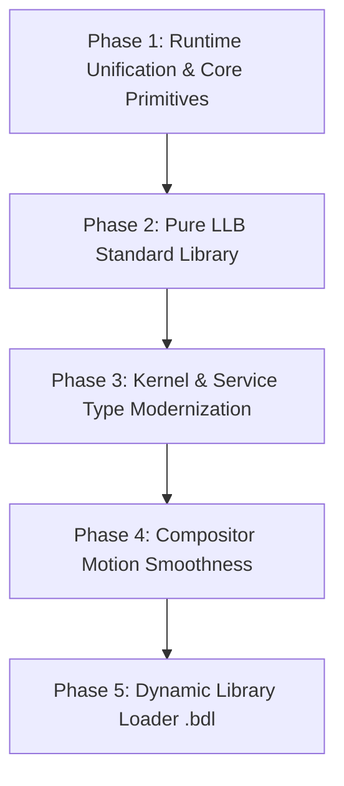

# PROS Runtime Architecture & Standard Library Modernization

> **Document Version:** 1.0.0  
> **Status:** Approved Architecture Blueprint  
> **Target Subsystems:** Basic Runtime (`lib/runtime`), Standard Library (`lib/pros`), Kernel & Service ABIs  

---

## 1. Executive Summary

This specification establishes the architectural blueprint for restructuring the PROS userland runtime, standard libraries, and type system. 

Historically, during the initial port from PRK (a procedural C kernel), C patterns were translated literally into Low-Level Basic (LLB)—such as manual ASCII byte arrays (`srvName(0) = 115`), duplicated CRT startup files (`brt0.S`), and raw pointer manipulation. This document defines the transition to a clean, idiomatic, high-performance ecosystem powered by native Low-Level Basic features, culminating in a dynamic library loader (`.bdl`).

```
┌────────────────────────────────────────────────────────────────────────┐
│                        User Application Binary                         │
├──────────────────────────────────┬─────────────────────────────────────┤
│  CRT Entry Stub (Static Object)  │    Shared Runtime / Standard Lib    │
│  PROS: lib/runtime/brt0.o        │    PROS: libpros.a (later .bdl)     │
│  • _start AMD64 stack alignment  │    • mem* suite (memcpy, memmove...)│
│  • CRT stack protector stubs     │    • String, Math, Stdio, Graphics  │
│  • Calls Main(), exits cleanly   │    • Synapse IPC, Nodes, VFS client │
└──────────────────────────────────┴─────────────────────────────────────┘
```

---

## 2. Low-Level Runtime Architecture (`lib/runtime`)

### 2.1 The Entry Stub (`brt0.S`)
In production operating systems (such as Linux `crt0.o` or Windows `mainCRTStartup`), the executable entry point **must** be a statically linked object file because shared libraries are not yet mapped when the kernel initiates task execution.

`lib/runtime/brt0.S` is the single, canonical freestanding entry point for all PROS userland executables:
- **AMD64 Stack Alignment:** Aligns `%rsp` to 16 bytes prior to invoking user `Main` (`andq $-16, %rsp`).
- **Stack Protector Primitives:** Defines `__stack_chk_guard` and `__stack_chk_fail` to satisfy LLVM canary emission.
- **Process Termination:** Traps return from `Main` and issues `SYS_PROCESS_EXIT` via `syscall`.
- **Minimal Footprint:** Contains zero extraneous data tables or driver blitters (~200 bytes compiled).

### 2.2 Complete `mem*` Operations Suite (`lib/runtime/mem.S`)
LLVM frequently lowers struct assignments, array copies, and zeroing loops to intrinsic calls (`memcpy`, `memset`, `memmove`, `memcmp`). To prevent compiler intrinsic failures and guarantee maximum CPU throughput, `lib/runtime/mem.S` provides the complete suite:

1. **`memcpy(dest, src, count)`**:
   - Optimized for non-overlapping memory buffers.
   - Executes 64-bit quadword block copies (`rep movsq`) followed by an unconditional fall-through for remaining tail bytes (`rep movsb`), guaranteeing `%rcx` register preservation.
2. **`memset(dest, val, count)`**:
   - Broadcasts the 8-bit fill value across a 64-bit register (`%rax`).
   - Executes quadword stores (`rep stosq`) followed by tail byte stores (`rep stosb`).
3. **`memmove(dest, src, count)`**:
   - **Crucial for overlapping memory regions** (e.g., terminal scrollback buffers, window stacking arrays, text editing).
   - Detects pointer overlap:
     - If `dest <= src` or `dest >= src + count`: standard forward copy (`cld; rep movsb`).
     - If `dest > src`: copies backward from the end (`std; rep movsb; cld`) so source data is never clobbered before being read.
4. **`memcmp(s1, s2, count)`**:
   - Lexicographical byte comparison returning `< 0`, `0`, or `> 0`.
5. **`strlen(str)`**:
   - High-speed null-byte scanner.

### 2.3 Modular Assembly Helpers
Data tables and specialized driver blitters are decoupled into dedicated assembly modules in `lib/runtime/`:
- `lib/runtime/font_8x16.S`: 8x16 VGA console bitmap font data.
- `lib/runtime/fast_blit32.S`: 32-bit aligned MMIO scanline burst blitter (`rep movsl`) for PCIe framebuffer flushes.

---

## 3. Pure Low-Level Basic Standard Library (`libpros`)

All general-purpose functionality is organized into modular pure LLB source files inside `lib/pros/src/`, exposed through `include/pros.bas`:

```
lib/pros/
├── Pros.llbproj
└── src/
    ├── String.bas     ' Format, AppendStr, AppendUInt, AppendHex, Trim, Split, StrEquals
    ├── Memory.bas     ' Strongly-typed wrappers for Copy, Move, Set, Compare, slices
    ├── Math.bas       ' Min, Max, Clamp, Abs, FixedPoint, Rect/Geometry operations
    ├── Stdio.bas      ' Print, PrintLine, Format, Hex/Dec formatters, stream helpers
    ├── Font.bas       ' Embedded font tables (5x7, 8x16), DrawGlyph, DrawText
    ├── Graphics.bas   ' Rect, Color, Point, Blit, Backbuffer canvas abstractions
    ├── Process.bas    ' Process management, yield, sleep, exit, synapse messaging
    └── Fs.bas         ' High-level file and directory access wrappers
```

### Module Responsibilities:
- **`Pros.String` (`String.bas`):** String parsing, conversions (`UIntToStr`, `HexToStr`, `StrToInt`), concatenation, case manipulation, trimming, and comparisons.
- **`Pros.Memory` (`Memory.bas`):** Safe buffer manipulation, slicing, and high-level typed bindings to `memcpy` and `memmove`.
- **`Pros.Math` (`Math.bas`):** Clamping, integer square roots, geometry arithmetic (`RectContains`, `RectIntersects`, `UnionRect`).
- **`Pros.Font` & `Pros.Gui` (`Font.bas`, `Graphics.bas`): Universal font rendering (`DrawText5x7`, `DrawGlyph10x10`) and surface blitting, eliminating duplicate rendering engines across the compositor, terminal, and system monitor.

---

## 4. Comprehensive Type Modernization

### 4.1 Userspace Modernization (PRK C Legacy Elimination)
During early porting, C-style stack arrays were translated verbatim:
```vb
' Legacy PRK C-style translation:
Dim srvName(32) As Byte
srvName(0) = 115 ' 's'
srvName(1) = 114 ' 'r'
srvName(2) = 118 ' 'v'
srvName(3) = 46  ' '.'
srvName(4) = 105 ' 'i'
...
vfsTable(2).Path = CPtr(Pointer To Byte, "/Apps/Terminal")
```

Under modern Low-Level Basic idioms, all services and applications transition to native `String` and structured records:
```vb
' Modern Low-Level Basic:
Dim srvName As String = "srv.input"

<Packed>
Structure VfsEntry
    Public Path      As String
    Public SizeBytes As UInt32
    Public Kind      As UInt32
    Public Perms     As UInt32
End Structure

vfsTable(2).Path = "/Apps/Terminal"
```

### 4.2 Kernel & ABI Type Modernization
The kernel ABI and public headers (`include/pros.bas`) will adopt strong semantic types rather than treating all handles and pointers as raw `UInt64`:
- `Type ProcessId = UInt64`
- `Type ThreadId = UInt64`
- `Type Handle = UInt64`
- `Type VirtualAddress = UInt64`
- `Type PhysicalAddress = UInt64`
- Strongly-typed `Enum` definitions for IPC commands, capability bitmasks, error codes, and node types.

---

## 5. Dynamic Library Loader (`.bdl`) Timing & Strategy

### 5.1 Architecture
The Basic Dynamic Library (`.bdl`) format is a position-independent or relocatable shared bundle containing:
1. Export symbol hash table.
2. Import relocation table (Global Offset Table / Procedure Linkage Table).
3. Read-only code/data segment (`.text`, `.rodata`).
4. Read-write template segment (`.data`, `.bss`).

### 5.2 Implementation Timing
> [!IMPORTANT]
> The dynamic library loader will be implemented **immediately after** the standard library modules and runtime have been unified and stabilized.

1. **ABI Stability:** Stabilizing `libpros` APIs first guarantees that symbol exports remain constant during dynamic linker development.
2. **Binary Shrink:** Once `libpros.bdl` is active, user binaries will drop from ~100 KB down to **4 KB – 8 KB**, sharing a single copy of `libpros` mapped at `0x60000000` in `PDPT[1]`.

---

## 6. Master Execution Roadmap



### Phase 1: Runtime Unification & Core Primitives
- [ ] **1.1** Create `lib/runtime/brt0.S` (AMD64 16-byte stack alignment, CRT stack protector stubs, clean exit).
- [ ] **1.2** Implement complete `mem*` suite in `lib/runtime/mem.S` (`memcpy`, `memset`, `memmove`, `memcmp`, `strlen`).
- [ ] **1.3** Move non-essential data and blitters to `lib/runtime/` (`font_8x16.S`, `fast_blit32.S`).
- [ ] **1.4** Update all 12 service and test `.llbproj` project manifests to reference `lib/runtime/brt0.S`.

### Phase 2: Pure Low-Level Basic Standard Library (`libpros`)
- [ ] **2.1** `String.bas`: `AppendStr`, `AppendUInt`, `AppendHex`, `StrEquals`, `Trim`, `Split`.
- [ ] **2.2** `Memory.bas`: Strongly-typed memory wrappers (`Copy`, `Move`, `Set`, `Compare`).
- [ ] **2.3** `Math.bas`: Min, Max, Clamp, Abs, Fixed-Point, Rect geometry math.
- [ ] **2.4** `Stdio.bas`: Print, PrintLine, Format, Hex/Dec formatters.
- [ ] **2.5** `Font.bas` & `Graphics.bas`: Centralized font rendering and surface blitting.
- [ ] **2.6** `Fs.bas`: High-level file and directory access wrappers.

### Phase 3: Comprehensive Kernel & Service Type Modernization
- [ ] **3.1** Kernel ABI: Semantic types (`ProcessId`, `Handle`, `VirtualAddress`), strongly-typed enums.
- [ ] **3.2** `include/pros.bas`: Modernize declarations to native `String` and semantic types.
- [ ] **3.3** Services Refactor: Purge C byte array hacks in favor of pure LLB `String` and structs.

### Phase 4: Compositor Motion Smoothness
- [ ] **4.1** Smooth out dirty-rect calculation, mouse event pacing, and window resize/drag corner alignment.

### Phase 5: Dynamic Library Loader (`.bdl`)
- [ ] **5.1** Implement `.bdl` dynamic loader in kernel/runtime.
- [ ] **5.2** Build `libpros` as `libpros.bdl`.
- [ ] **5.3** Convert user applications to dynamically link `libpros.bdl`.

